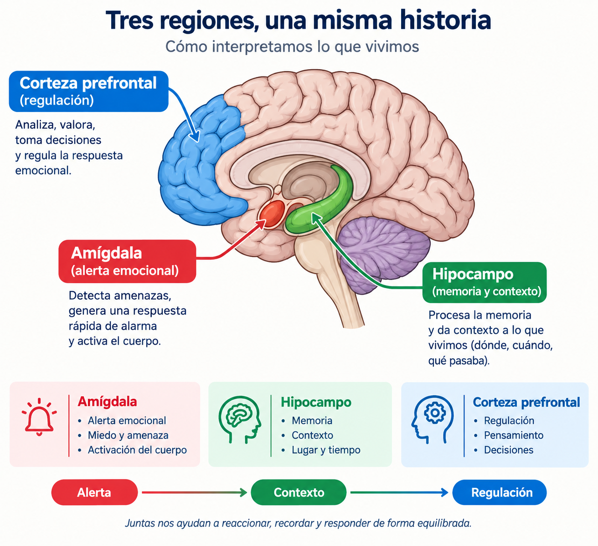
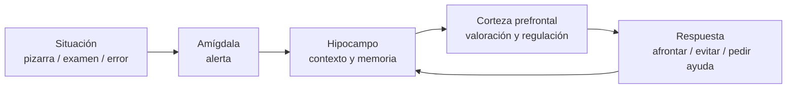

# Tres regiones, una misma historia: cómo interpretamos lo que vivimos

**Asignatura:** Educación emocional en el profesorado  
**Uso:** apoyo visual y conceptual al [Tema 7 — Neuroeducación](../apuntes/07-neuroeducacion-precauciones.md) y al [apunte de estrés](../apuntes/estres-impacto-y-gestion-emocional.md).  
**Precaución:** modelo didáctico simplificado; no es un mapa anatómico exhaustivo ni justifica neuromitos.



> Infografía: amígdala (alerta), hipocampo (memoria y contexto) y corteza prefrontal (regulación). Flujo: **Alerta → Contexto → Regulación**.

---

## 1. Idea central

La emoción y el estrés no «viven» en un solo lugar del cerebro. Tres sistemas cooperan (y a veces compiten) cuando interpretamos una situación de aula:

| Región | Función orientativa | En el aula de Matemáticas |
|--------|---------------------|---------------------------|
| **Amígdala** | Alerta emocional: detecta amenaza, genera respuesta rápida, activa el cuerpo | El anuncio de «examen sorpresa» o salir a la pizarra puede disparar alarma antes de pensar |
| **Hipocampo** | Memoria y contexto: dónde, cuándo, qué pasaba | Recuerdos de fracasos previos colorean la valoración del problema actual |
| **Corteza prefrontal** | Regulación: analiza, valora, decide, modula la respuesta emocional | Releer el enunciado, elegir una estrategia, pedir una pista en lugar de abandonar |

```text
  Alerta (amígdala)  →  Contexto (hipocampo)  →  Regulación (corteza prefrontal)
```

Juntas nos ayudan a **reaccionar**, **recordar** y **responder** de forma más equilibrada. Cuando el distrés es muy alto, la alerta puede «ganar» y reducir temporalmente la capacidad de planificar (función ejecutiva).

---

## 2. Flujo didáctico (no mecánico)



- La secuencia **no** es rígida: hay idas y vueltas.  
- El **contexto** (hipocampo) puede calmar o amplificar la alerta («esto se parece a cuando me humillaron» vs. «he resuelto problemas parecidos»).  
- La **regulación** (prefrontal) se entrena: reevaluación, respiración, primer paso concreto, apoyo social.

---

## 3. Conexión emociones ↔ estrés (bidireccional)

1. **Las emociones modulan el estrés**  
   Miedo, ansiedad, ira, culpa o vergüenza pueden activar la respuesta de estrés (adrenalina, cortisol, tensión). La **valoración cognitiva** decide si la misma situación se vive como amenaza o como desafío. Emociones positivas, humor o gratitud pueden amortiguar.

2. **El estrés altera las emociones**  
   Agudo: ansiedad, irritabilidad, impaciencia. Crónico: labilidad, tristeza, apatía, anhedonia, mayor reactividad o embotamiento; puede reducir la capacidad de regular.

3. **Comparten circuitos**  
   Amígdala (alerta), hipocampo (contexto), corteza prefrontal (regulación). El estrés crónico puede dificultar la regulación; una mala regulación mantiene activado el estrés.

4. **No son lo mismo**  
   El estrés es respuesta ante demandas percibidas; las emociones son reacciones afectivas más específicas. Se solapan en lo fisiológico, cognitivo y conductual.

**Implicación docente:** regular emociones (reevaluación, respiración, apoyo, sueño, límites) reduce estrés; manejar mejor el estrés mejora el equilibrio emocional. Si interfiere en la vida diaria: recursos profesionales / protocolos del centro.

---

## 4. Qué sí y qué no hacer con este modelo

| Sí | No |
|----|----|
| Usarlo para explicar por qué un alumno «se bloquea» aunque sepa el procedimiento | Diagnosticar «problemas de amígdala» en el alumnado |
| Diseñar tareas que den contexto seguro y tiempo de regulación | Justificar que «hay cerebros de mates y cerebros que no» |
| Entrenar reevaluación y primer paso (prefrontal) | Sustituir didáctica y psicología educativa por imágenes de cerebro |
| Conectar con ansiedad matemática y clima de error | Presentar el esquema como circuito cerrado o determinista |

---

## 5. Actividad breve (5–10 min)

1. El docente describe una situación típica (salir a la pizarra / examen de sistemas).  
2. En parejas: ¿qué podría hacer la *alerta*, el *contexto* y la *regulación* en esa escena?  
3. Puesta en común: una estrategia concreta de regulación útil en mates (releer, empezar por lo conocido, pedir pista, respirar 3 ciclos).

---

## 6. Enlaces en el repo

- [Tema 7 — Neuroeducación](../apuntes/07-neuroeducacion-precauciones.md)  
- [Estrés: impacto y gestión emocional](../apuntes/estres-impacto-y-gestion-emocional.md)  
- [Tema 2 — Naturaleza de la emoción](../apuntes/02-naturaleza-de-la-emocion.md)  
- [Ansiedad matemática](../../../psicologia-del-desarrollo-y-de-la-educacion/materiales/ansiedad-matematica-aula.md)  
- [Glosario de la optativa](../glosario.md)

---

## 7. Lecturas orientativas

LeDoux, J. (2015). *Anxious: Using the brain to understand and treat fear and anxiety*. Viking.  
Phelps, E. A., & LeDoux, J. E. (2005). Contributions of the amygdala to emotion processing. *Neuron*.  
Arnsten, A. F. T. (2009). Stress signalling pathways that impair prefrontal cortex structure and function. *Nature Reviews Neuroscience*.  
Immordino-Yang, M. H., & Damasio, A. (2007). We feel, therefore we learn. *Mind, Brain, and Education*.

*(Usar como marco de plausibilidad; la práctica de aula se apoya prioritariamente en psicología educativa y didáctica.)*
