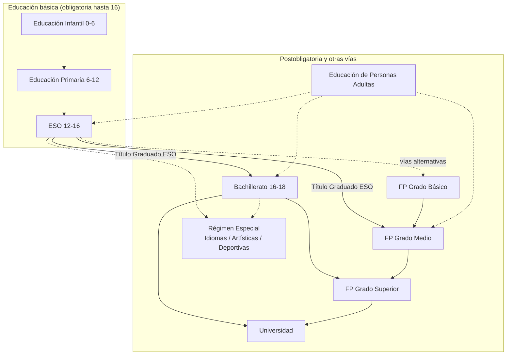

# Tema 2: Estructura del Sistema Educativo Español (Secundaria, FP y Enseñanzas de Régimen Especial)

**Asignatura:** Procesos y contextos educativos  
**Programa:** [tema 2](../programa.md)

> Mapa del sistema: etapas, titulaciones e itinerarios. El profesor de Matemáticas orienta y colabora en decisiones de itinerario; no solo «imparte su materia».

---

## 1. Visión general del sistema educativo español

El sistema educativo español se organiza en etapas sucesivas que combinan enseñanza obligatoria y postobligatoria, con vías paralelas de régimen especial y educación de personas adultas.

**Clasificación clave:**
- **Obligatorias:** Primaria + ESO (hasta los 16 años).
- **Postobligatorias:** Bachillerato, FP de Grado Medio y Superior, enseñanzas artísticas superiores, etc.
- **Régimen especial:** paralelas a la ordinaria, con centros específicos (EOI, conservatorios, centros de enseñanzas deportivas).
- **Educación de Personas Adultas:** vías de incorporación, preparación de pruebas de acceso y formación continua.

La **LOGSE** (1990) generalizó la ESO hasta los 16 años. La **LOMLOE** (2020) mantiene esa obligatoriedad y refuerza los principios de equidad, inclusión, orientación y aprendizaje permanente.

### Tabla comparativa sintética

| Aspecto | ESO | Bachillerato | FP (Grado Medio / Superior) |
|---------|-----|--------------|-----------------------------|
| **Duración** | 4 cursos | 2 cursos | Variable (módulos; habitualmente 2 años) |
| **Finalidad** | Formación básica común + ciudadanía | Madurez intelectual + acceso a superior | Cualificación profesional + empleo |
| **Evaluación** | Continua, formativa e integradora | Continua + peso de EvAU | Continua + módulos + empresa (Dual) |
| **Promoción** | Colegiada; criterios estatales + autonómicos | Según normativa de etapa | Por módulos superados |
| **Titulación** | Graduado en ESO | Título de Bachiller | Técnico / Técnico Superior |
| **Matemáticas** | Común + A/B en 4.º | I-II o Aplicadas a CCSS | Según ciclo (suelen ser aplicadas) |

---

## 2. Marco normativo y principios fundamentales de la LOMLOE

La Ley Orgánica 3/2020, de 29 de diciembre, por la que se modifica la LOE (LOMLOE) establece los principios vertebradores del sistema:

- **Equidad e inclusión:** garantizar que todo el alumnado alcance el máximo desarrollo posible de sus capacidades.
- **Coeducación:** eliminación de estereotipos de género y promoción de la igualdad real.
- **Enfoque competencial:** aprendizaje orientado a competencias clave y específicas, no solo a contenidos disciplinares.
- **Aprendizaje permanente:** la educación no termina con la etapa obligatoria; se potencia la formación a lo largo de la vida.
- **Alineación con los ODS (Agenda 2030)** y con los marcos europeos de cualificaciones.

Estos principios se concretan en los reales decretos de ordenación y en los decretos autonómicos de currículo. En Aragón, el desarrollo curricular específico (nivel de concreción autonómico) debe consultarse siempre en el BOA y en la web del Departamento de Educación.

> **Enlace cruzado:** la perspectiva histórica y de paradigmas se desarrolla en el [Tema 1 — Evolución histórica del sistema educativo y paradigmas](01-evolucion-historica-sistema-educativo-paradigmas.md).

---

La LOMLOE articula su propuesta en torno a la modernización, la búsqueda de resultados, la estabilidad y la equidad. Sus principios rectores abarcan la calidad y los derechos de la infancia, la igualdad de género y coeducación, la transición ecológica justa, el fomento del espíritu crítico, la inclusión con accesibilidad universal (funcional, social e intercultural), la convivencia, la investigación, el esfuerzo compartido, la participación, la libertad de elección de centro y el aprendizaje permanente, alineándose con el ODS 4. El sistema se estructura en Infantil (0-2, 3-5 años), Educación Básica (Primaria, ESO y CFGB) y Postobligatoria (Bachillerato, FP Grado Medio, enseñanzas artísticas y deportivas), integrando además la Educación Superior, la Educación de Personas Adultas y las enseñanzas de idiomas (EOI, niveles A1-C2).

No obstante, el análisis crítico detecta tensiones: se observa una descentralización autonómica que a veces colisiona con los objetivos de la Agenda 2030, y una tendencia a culpar a la normativa previa en los preámbulos. Desde la investigación académica, autores como Coll y Martín, Esteban y Gil, López Rupérez y Serrano et al. han identificado desafíos significativos, tales como el posible solapamiento entre competencias y saberes, el riesgo de un enfoque excesivamente utilitarista, la necesidad de mayor financiación y formación, y la carencia de competencias transversales críticas como la resiliencia a la exclusión o la capacidad de abstracción. Asimismo, se advierte sobre la cautela necesaria ante la correlación entre variables educativas y resultados, y el debate sobre la segregación real frente al modelo de escuela-burbuja.

## 3. Educación Secundaria Obligatoria (ESO)

### Finalidad y principios pedagógicos
La ESO tiene como finalidad proporcionar al alumnado una formación elemental, transmitir los elementos básicos de la cultura y preparar para el ejercicio de derechos y obligaciones de la vida ciudadana, así como para el acceso a la formación profesional o al Bachillerato.

Principios pedagógicos destacados por la LOMLOE:
- Atención a la diversidad como principio ordinario del aula.
- Orientación educativa y profesional continua.
- Trabajo por competencias y situaciones de aprendizaje.
- Evaluación continua, formativa e integradora.

### Organización por cursos y materias
- Cuatro cursos (1.º a 4.º).
- Materias comunes, de opción y optativas.
- En 4.º de ESO se introducen vías diferenciadas (entre ellas, Matemáticas A / Matemáticas B según el desarrollo autonómico).

### Medidas de organización flexible y atención a la diversidad
- Agrupamientos flexibles, desdobles y apoyos ordinarios.
- Programas de diversificación curricular (a partir de 3.º).
- Medidas de refuerzo y ampliación.
- Adaptaciones curriculares y planes individualizados cuando proceda.

### Evaluación, promoción y titulación
- Evaluación continua; la decisión de promoción se adopta de forma colegiada.
- El título de **Graduado en Educación Secundaria Obligatoria** se obtiene al superar la etapa (con las condiciones de promoción y evaluación establecidas en la normativa estatal y autonómica).

**Implicación para el profesorado de Matemáticas:** sentido de la materia en la alfabetización ciudadana; asesoramiento en la elección de itinerarios de 4.º; atención a la diversidad en grupos heterogéneos.

---

## 4. Bachillerato

### Finalidad y organización general
El Bachillerato tiene como finalidad proporcionar al alumnado formación, madurez intelectual y humana, conocimientos, habilidades y actitudes que le permitan desarrollar funciones sociales e incorporarse a la vida activa con responsabilidad y competencia. Asimismo, capacita para acceder a la educación superior.

Duración: dos cursos.

### Modalidades
- Ciencias y Tecnología
- Humanidades y Ciencias Sociales
- Artes
- **Bachillerato General** (modalidad introducida/reforzada por la LOMLOE para ofrecer un itinerario más flexible)

Materias: comunes, de modalidad y optativas.

### Metodología, evaluación, promoción y titulación
- Enfoque competencial y trabajo por proyectos/situaciones de aprendizaje.
- Evaluación continua; promoción de 1.º a 2.º con las condiciones normativas.
- Título de Bachiller.
- Acceso a la universidad mediante la EvAU/EBAU (o equivalente) y a ciclos formativos de Grado Superior.

**Matemáticas en Bachillerato:**
- Matemáticas I y II (modalidad de Ciencias y Tecnología).
- Matemáticas Aplicadas a las Ciencias Sociales I y II.

El peso de la evaluación externa de acceso a la universidad condiciona en buena medida la práctica docente.

---

## 5. Formación Profesional

La LOMLOE y la normativa posterior de FP (Ley Orgánica 3/2022 y desarrollos) reordenan la Formación Profesional en grados vinculados al Catálogo Nacional de Cualificaciones Profesionales y al tejido productivo.

| Grado | Acceso principal | Titulación | Continuidad |
|-------|------------------|------------|-------------|
| **Básico** | Alumnado que no ha completado la ESO en condiciones ordinarias | Título de Graduado en ESO + título profesional básico | FP de Grado Medio |
| **Medio** | Título de Graduado en ESO u otras vías | Título de Técnico | FP de Grado Superior |
| **Superior** | Bachillerato, Grado Medio u otras vías | Título de Técnico Superior | Universidad (con reconocimiento de créditos en muchos casos) |

**Características clave:**
- Estructura modular.
- Formación Profesional Dual (combinación centro + empresa).
- Criterios de inclusión y acreditación de competencias profesionales.
- Fuerte orientación al empleo y a la cualificación a lo largo de la vida.

El docente de Matemáticas en ESO y Bachillerato debe conocer estas salidas para **no reducir la orientación** a «solo universidad».

---

## 6. Otras enseñanzas y Educación de Personas Adultas (EPA)

### Enseñanzas de Régimen Especial
Son enseñanzas paralelas (no sustitutas) de la ordinaria. Se cursan habitualmente en centros específicos y pueden ser compatibles con ESO o Bachillerato (con ajustes de horario y posibles reconocimientos).

| Familia | Centros / ejemplos |
|---------|---------------------|
| **Idiomas** | Escuelas Oficiales de Idiomas (EOI) |
| **Artísticas** | Conservatorios y escuelas de Música, Danza, Arte Dramático, Artes Plásticas y Diseño |
| **Deportivas** | Centros de enseñanzas deportivas de régimen especial |

### Educación de Personas Adultas
Ofrece vías de incorporación al sistema, preparación para pruebas de acceso (ESO, Bachillerato, FP, universidad) y formación continua. Es un elemento esencial del principio de aprendizaje permanente de la LOMLOE.

---

## 7. Orientación educativa, itinerarios y rol del profesorado de Matemáticas

La orientación es una función de todo el equipo docente, coordinada por el departamento de orientación y los tutores.

### Momentos clave de toma de decisiones
- Optativas y vías en 4.º de ESO (incluido el desdoble Matemáticas A / B o equivalentes).
- Elección de modalidad de Bachillerato.
- Acceso a FP de Grado Medio o Superior.
- Compatibilidad con enseñanzas de régimen especial.

### Bifurcación de itinerarios matemáticos
| Etapa | Opciones habituales | Orientación recomendada |
|-------|---------------------|-------------------------|
| 4.º ESO | Matemáticas A / Matemáticas B (o denominación autonómica equivalente) | Informar con realismo sobre exigencias de Bachillerato y FP |
| Bachillerato | Matemáticas I-II vs. Matemáticas Aplicadas a las CCSS I-II | Vincular con la modalidad elegida y con el acceso a grados universitarios o ciclos superiores |

**Coll (2010)** insiste en que la Secundaria es una etapa de **desarrollo** y de **transición**: el aprendizaje escolar se cruza con la construcción de la identidad, las relaciones entre iguales y el proyecto de futuro. La estructura del sistema solo tiene sentido si el centro orienta con información realista y sin estigmas («FP = fracaso»).

### Caso Aragón — currículo e itinerarios de Matemáticas
En Aragón el nivel 1 de concreción se fija con los reales decretos de enseñanzas mínimas **más** el decreto autonómico de currículo. Ahí se concretan competencias específicas, criterios de evaluación y saberes básicos.

**Para el practicum o la programación en un centro aragonés:**
- Consultar los [temarios de Matemáticas ESO/Bachillerato (Aragón)](../../diseno-curricular-e-instruccional-de-matematicas/materiales/temarios-matematicas-aragon/) del repositorio.
- Cruzar con [asignaturas ESO/Bachillerato](../../diseno-curricular-e-instruccional-de-matematicas/materiales/asignaturas-eso-bachillerato/) y con [elementos del currículo LOMLOE](../../diseno-curricular-e-instruccional-de-matematicas/apuntes/03-elementos-curriculo-lomloe.md).
- Verificar siempre el decreto y órdenes vigentes en el BOA / web del Departamento de Educación (actualización 2026).

---

## 8. Debates actuales, preguntas de repaso y dimensión crítica

### Debates abiertos
- **Comprensividad vs. diversificación precoz:** ¿hasta qué punto debe mantenerse un tronco común hasta los 16 años?
- **Inclusión real en el aula ordinaria:** distancia entre el discurso normativo y los recursos efectivos (ratios, formación, ratios).
- **Brecha entre norma, financiación y currículo competencial:** la LOMLOE apuesta por un enfoque competencial exigente; su aplicación depende de condiciones materiales y de la formación del profesorado.
- **Perfil de salida vs. realidad del alumnado a los 16 años:** el Perfil de salida plantea horizontes ambiciosos (conciencia ambiental, consumo responsable, espíritu crítico, etc.). La brecha con las condiciones reales de aula (ratios, ratios, heterogeneidad) es un debate legítimo que no se resuelve solo con más matrices documentales. Desarrollo ampliado: [Desafíos del contexto docente y aplicación LOMLOE (2025–2026)](../materiales/desafios-contexto-docente-lomloe-2026.md).

Estos debates se conectan con la evolución histórica y los paradigmas analizados en el [Tema 1](01-evolucion-historica-sistema-educativo-paradigmas.md).

### Preguntas de autoevaluación
1. Diferencia ESO, Bachillerato y un ciclo de FP de Grado Medio en cuanto a finalidad y titulación.
2. ¿Qué aporta conocer las enseñanzas de régimen especial para un tutor de 3.º de ESO?
3. ¿Cómo evitar que la orientación reduzca las salidas a «universidad o nada»?
4. Relaciona la existencia de Matemáticas A/B (o equivalentes) con la estructura de 4.º de ESO y con el asesoramiento tutorial.
5. Identifica al menos dos principios de la LOMLOE que se concretan de forma distinta en ESO y en Bachillerato.

---

## Anexo. Glosario breve y referencias

**Glosario:** ESO · Graduado en ESO · Bachillerato · Modalidad · FP (grados Básico / Medio / Superior) · FP Dual · Régimen especial · EOI · Itinerario · Orientación educativa · Diversificación curricular · EvAU/EBAU

### Material relacionado del repositorio
- [Programa de la asignatura](../programa.md)
- [Tema 1 — Evolución histórica y paradigmas](01-evolucion-historica-sistema-educativo-paradigmas.md)
- [**Desafíos del contexto docente y aplicación LOMLOE (2025–2026)**](../materiales/desafios-contexto-docente-lomloe-2026.md)
- [Temarios Matemáticas Aragón](../../diseno-curricular-e-instruccional-de-matematicas/materiales/temarios-matematicas-aragon/)
- [Asignaturas ESO/Bachillerato de Matemáticas](../../diseno-curricular-e-instruccional-de-matematicas/materiales/asignaturas-eso-bachillerato/)
- [Elementos del currículo LOMLOE](../../diseno-curricular-e-instruccional-de-matematicas/apuntes/03-elementos-curriculo-lomloe.md)

### Referencias bibliográficas y normativas (selección)
- Ley Orgánica 3/2020, de 29 de diciembre (LOMLOE).
- Reales decretos de ordenación de ESO, Bachillerato y FP vigentes.
- Decreto de currículo de Aragón correspondiente (consultar BOA actualizado).
- Coll, C. (2010). *Desarrollo, aprendizaje y enseñanza en la educación secundaria*. Graó.
- Imbernón, F. (2010). *Procesos y contextos educativos*. Graó.
- Ver listado completo en [bibliografía de la asignatura](../bibliografia.md).

> **Nota sobre fuentes:** el contenido de este apunte es redacción original basada en la normativa vigente y en la bibliografía de referencia de la asignatura. Cualquier material externo utilizado como inspiración se cita de forma explícita y se respeta su licencia.

<!-- CANONICO_INICIO: sintetico-canonico-procesos-y-contextos-educativos.md::sec-3 -->
## Sincronizado desde el canónico — 3. Estructura de las enseñanzas: ESO, Bachillerato y FP (Tema 2)

> Fuente: `asignaturas/1erTrimestre/procesos-y-contextos-educativos/sinteticos/sintetico-canonico-procesos-y-contextos-educativos.md`

La LOMLOE persigue la modernización del currículo, la mejora de los resultados, la recuperación de la equidad y la estabilidad de una política educativa coherente con los compromisos internacionales de España. Entre sus principios destacan la inclusión educativa y la accesibilidad universal, la educación de calidad para todo el alumnado y el cumplimiento efectivo de los derechos de la infancia, la igualdad de género y el respeto a la diversidad afectivo-sexual y familiar, el espíritu crítico y la ciudadanía activa, la educación para la transición ecológica desde principios de justicia social, la convivencia y la resolución pacífica de conflictos, el aprendizaje a lo largo de la vida, el esfuerzo individual y compartido, la participación de la comunidad educativa, la investigación y la innovación, el derecho de las familias a elegir centro y la adaptación a los cambios del alumnado y de la sociedad.

El sistema se organiza en Educación Infantil, dividida en un primer ciclo de 0 a 2 años y un segundo ciclo de 3 a 5; Educación Básica, obligatoria y gratuita, que comprende la Educación Primaria, la ESO y los Ciclos Formativos de Grado Básico; y Educación Postobligatoria, con el Bachillerato, la FP de Grado Medio y Superior y las enseñanzas artísticas y deportivas. Se añaden la Educación Superior y las enseñanzas para personas adultas, entre ellas las de idiomas de las escuelas oficiales, con niveles básico A1 y A2, intermedio B1 y B2 y avanzado C1 y C2. La lectura y el comentario de los preámbulos de la LOE y la LOMLOE permitieron trabajar los derechos de la infancia, la igualdad y la coeducación, el éxito escolar mediante el acompañamiento, la evaluación formativa y la personalización, la inclusión en sus dimensiones funcional, social e intercultural, el objetivo de desarrollo sostenible número 4, la convivencia y la libertad de elección de centro. También se detectaron contradicciones: ambos preámbulos culpan a la ley anterior de los males del sistema; se suprimen los itinerarios en nombre de la diversidad mientras se mantiene un currículo común; y la descentralización autonómica convive con los compromisos de la Agenda 2030. El comentario de artículos se apoyó en la lectura estratégica —título, resumen, palabras clave, estructura y conclusión— y en el esquema diagnóstico, fallos y alternativas aplicado a Coll y Martín, Esteban y Gil, López Rupérez y Serrano y colaboradores. Se pusieron sobre la mesa las competencias ausentes, como la resiliencia ante la exclusión o la abstracción, la tensión entre la escuela burbuja y la segregación real que revelan la prueba de acceso a la universidad, las oposiciones y los números clausus, la cautela metodológica de que correlación no implica causalidad y la necesidad de consenso entre Estado y comunidades en materia de recursos.

Coll y Martín (2021) ofrecen una lectura equilibrada de la LOMLOE y la consideran una oportunidad de modernización curricular: valoran positivamente el perfil de salida, pero advierten de que las competencias clave son demasiado abstractas y dificultan la selección de contenidos, por lo que proponen distinguir entre aprendizajes básicos imprescindibles y deseables y evitar currículos sobredimensionados. López Rupérez (2022) adopta una postura crítica y denuncia la ambigüedad de los criterios de evaluación, la mezcla indistinta de conocimientos, destrezas y actitudes bajo la etiqueta de saberes básicos, la vaguedad de los descriptores operativos y el riesgo de que la autonomía de las comunidades aumente las desigualdades; su alternativa es recuperar el rigor y reconocer que nadie puede saber hacer sin un conocimiento previo básico de la materia. Serrano y colaboradores (2025) realizaron una investigación con entrevistas a docentes y codificación cualitativa en tres fases, y encontraron que una parte del profesorado ve la ley viable y coherente, mientras otra señala la falta de tiempo, de recursos humanos y de formación; concluyen que muchas mejoras se deben al esfuerzo docente y no a la ley y proponen acompañamiento institucional, formación y transición progresiva. Esteban y Gil (2022) critican el enfoque utilitarista de la legislación y Vigo-Arrazola y colaboradores (2022) reclaman menos poesía y más hechos en materia de financiación.

En el debate desarrollado en clase se discutieron la pérdida de nivel, la politización de la ley y el peso de las competencias, con el ejemplo del *Quijote* para ilustrar que el conocimiento de una obra puede formar parte de una competencia cultural. Se recordó que el recurso presentado por un partido ante el Tribunal Constitucional fue desestimado y que conviene no recitar la ley, sino saber hacia dónde va y cuáles son los fines de la educación, uniendo historia, referentes pedagógicos y normativa vigente. Como comentario adicional, la mesa redonda sobre la reforma puso sobre la mesa cinco medidas inmediatas: un núcleo curricular estable y simplificado, con aprendizajes básicos imprescindibles y estándares claros; la desburocratización de la labor docente para recuperar tiempo para preparar clases y atender al alumnado; la inversión prioritaria en personal especializado y en inclusión real, con más orientación, pedagogía terapéutica y audición y lenguaje y reducción de ratios; un plan nacional de formación docente práctica y acompañada en el propio centro; y un pacto de estabilidad normativa que despolitice los currículos y respete la pluralidad y la libertad de elección de las familias. El punto de encuentro fue la defensa de una formación integral, con rigor en los saberes básicos, respeto a la pluralidad y equidad real, sin caer ni en una educación memorística y enciclopédica desvinculada de la vida ni en una educación vacía de contenidos.

En Formación Profesional se trabajaron distintos recorridos de acceso y formación: la microformación a partir de los 15 años, los módulos, los certificados de profesionalidad de unas 500 o 600 horas dependientes del ministerio de empleo, los ciclos de grado medio y superior y la especialización o posgrado. Se mencionaron los portales oficiales de empleo y formación y la FP Dual, con prácticas retribuidas y redes de contacto, además de la reivindicación de oficios y tradiciones artesanales.

La ESO se organiza en cuatro cursos para alumnado de 12 a 16 años y adopta un modelo competencial, práctico e interdisciplinar con finalidades culturales, de estudio y trabajo y de ciudadanía. Las novedades de la LOMLOE incluyen la mejora del acompañamiento en la transición de Primaria, la definición de un perfil de salida vinculado a ocho competencias clave, un proyecto interdisciplinar o de servicio a la comunidad en horario lectivo, la agrupación de materias por ámbitos, la desaparición de itinerarios, de la jerarquía entre materias y de la reválida de etapa, los programas de diversificación curricular y de formación profesional básica desde tercero con título único, la limitación de la repetición a una vez en la etapa y dos en la educación obligatoria, la evaluación de diagnóstico en segundo curso y el consejo orientador en cuarto, y la religión con oferta obligada y elección voluntaria. En los tres primeros cursos son materias comunes Biología y Geología o Física y Química, Educación Física, Educación Plástica y Visual, Geografía e Historia, Lengua Castellana y Literatura y, en su caso, cooficial, Lengua Extranjera, Matemáticas, Música y Tecnología y Digitalización, además de las optativas de cada comunidad. En cuarto curso se refuerza el carácter orientador y las matemáticas se ofrecen en dos opciones. La evaluación es continua, formativa e integradora, de modo que promocionan quienes superan todas las materias o suspenden como máximo dos, y la repetición es excepcional y requiere un plan personalizado.

El Bachillerato dura dos cursos, con posibilidad de tres y un máximo de cuatro, y se accede con el título de Graduado en ESO o con títulos de FP o de enseñanzas artísticas y deportivas. Las novedades incluyen la sostenibilidad, la madurez afectivo-sexual, la creación de la modalidad General, la flexibilidad para cursar asignaturas en otro centro o a distancia, el refuerzo de la orientación, la titulación por compensación de una materia y una prueba de acceso a la universidad con enfoque competencial. Las modalidades son Ciencias y Tecnología, Humanidades y Ciencias Sociales, Artes, con dos vías, y General. Son materias comunes de primer curso Educación Física, Filosofía, Lengua Castellana y Literatura I y Lengua Extranjera I, y de segundo curso Historia de la Filosofía, Historia de España, Lengua Castellana y Literatura II y Lengua Extranjera II, según el orden ECD/739/2025. La titulación exige superar todas las materias o una sola, con nota media igual o superior a 5, sin perjuicio de la prueba para mayores de 20 años, el Bachillerato para adultos y la convalidación con títulos de FP o de enseñanzas artísticas.

La Formación Profesional capacita para el ejercicio de una profesión, el empleo y la participación social, y se organiza en formación inicial reglada, inserción y formación continua, con grados Básico, Medio, Superior y de especialización. El Ciclo Formativo de Grado Básico está dirigido a alumnado de 15 años que cursa tercero de ESO por propuesta del equipo docente, comprende ámbitos de Comunicación y Ciencias Sociales, Ciencias Aplicadas y Profesional con formación en centros de trabajo, y permite obtener el título técnico básico junto con el de Graduado en ESO. El acceso al grado medio se realiza con el Graduado en ESO, un curso de adaptación o una prueba a partir de los 17 años, y al grado superior con el Bachillerato, el título de Técnico Medio, un curso preparatorio o un título superior. La evaluación se organiza por módulos, con acreditación parcial acumulable, y en Aragón el Decreto 91/2024 regula estos aspectos. Entre las novedades figuran la FP Dual, el reconocimiento de la experiencia laboral, los programas de segundas oportunidades y las adaptaciones para el alumnado con necesidades específicas de apoyo educativo.
<!-- CANONICO_FIN: sintetico-canonico-procesos-y-contextos-educativos.md::sec-3 -->
