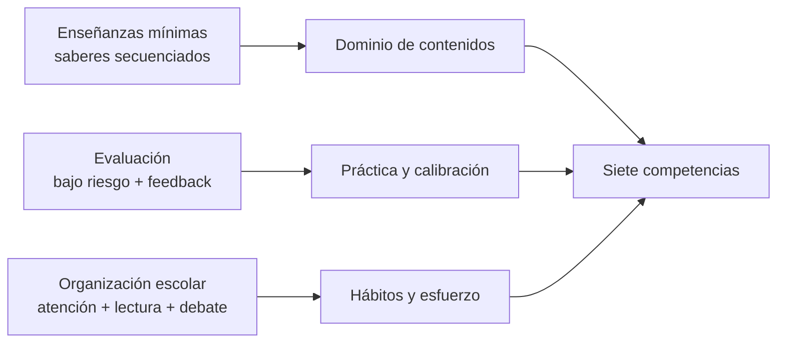

# Siete competencias que el currículo español no entrena

**Propuesta depurada · borrador de trabajo · 21 de octubre de 2026**  
**Asignatura:** Procesos y contextos educativos (ampliable a Diseño curricular)  
**Conexión:** [Críticas y debate LOMLOE](criticas-debate-lomloe-sesion-2026-10-19.md) · [Desafíos del contexto docente](desafios-contexto-docente-lomloe-2026.md) · [Evaluación competencial](evaluacion-competencial-matematicas-lomloe.md) · [Tema 1](../apuntes/01-evolucion-historica-sistema-educativo-paradigmas.md)

> Documento de trabajo / análisis crítico. No es posición oficial del máster.  
> Se ofrece como material de debate sobre el marco competencial y posibles palancas normativas.

---

## 1. Tesis y alcance

El marco competencial que vertebra la LOMLOE no es una ocurrencia española ni un mandato europeo: es el resultado de una convergencia supranacional de políticas educativas, adoptada voluntariamente por los Estados. La crítica más sólida no apunta a una ley concreta, sino a ese marco, que describe bien qué debe saber hacer un joven y dice muy poco sobre cómo se construyen las capacidades que lo hacen posible: conocimiento consolidado, abstracción, esfuerzo sostenido, atención y manejo del error. Este documento propone siete competencias y, sobre todo, las palancas normativas que pueden entrenarlas.

---

## 2. De dónde viene el marco

### Lo verificado

- Las competencias clave, las competencias específicas, los descriptores operativos y el perfil de salida son una adaptación de la Recomendación del Consejo de la UE de 22 de mayo de 2018, según el propio Ministerio.
- El preámbulo de la LOMLOE declara que actualiza los objetivos de la LOE de acuerdo con los objetivos europeos y les suma planteamientos de la Agenda 2030.

### Matices necesarios

- La Agenda 2030 es un acuerdo de la Asamblea General de la ONU (2015), no un órgano de la UE. La UE se ha comprometido a aplicarla, pero son instancias distintas.
- Los artículos 165 y 166 del TFUE limitan el papel de la UE en educación a apoyar, coordinar y complementar la acción de los Estados; el artículo 165 excluye expresamente la armonización normativa. La Recomendación de 2018 es *soft law*: la adoptaron por unanimidad todos los Estados miembros, España incluida, y no es vinculante.
- El lenguaje de competencias ya estaba en la LOE de 2006 («competencias básicas») y se mantuvo en la LOMCE de 2013 («competencias clave»). El marco no es patrimonio de una mayoría parlamentaria concreta.
- El propio marco europeo incluye alfabetización, competencia matemática y científica: llamarlo «blando» sin más es una simplificación.

La tesis defendible no es «Bruselas obliga», sino **isomorfismo normativo y gobernanza blanda**: indicadores, benchmarks y recomendaciones no vinculantes que, por prestigio y homologación, acaban moldeando los currículos nacionales.

**Referencias orientativas:** Novoa y Lawn (eds.), *Fabricating Europe* (2002); Grek, «Governing by numbers: the PISA effect in Europe» (2009); Sahlberg, «The Global Educational Reform Movement» (2011); Rizvi y Lingard, *Globalizing Education Policy* (2010); Rychen y Salganik (eds.), *Key Competencies for a Successful Life* (2003), origen del enfoque DeSeCo de la OCDE; Gimeno Sacristán, *Educar por competencias, ¿qué hay de nuevo?* (2008).

**Consecuencia práctica.** Como el Estado fija las enseñanzas mínimas y las comunidades autónomas las desarrollan, buena parte de lo que se propone aquí cabe dentro del margen nacional sin chocar con ningún compromiso europeo.

---

## 3. Las siete competencias

### 3.1 Conocimiento consolidado y memoria

**Tesis.** No se puede razonar sobre lo que no se tiene en memoria a largo plazo. Los expertos no piensan «mejor» en abstracto: reconocen patrones porque saben mucho (Chase y Simon, 1973).

**Evidencia.** La práctica de recuperación (Roediger y Karpicke, 2006), el repaso espaciado (Cepeda et al., 2006) y la revisión de técnicas de estudio de Dunlosky et al. (2013) son de las intervenciones con mejor respaldo en psicología de la educación.

**Matiz.** La ley no prohíbe memorizar; el problema es de énfasis, evaluación y práctica de aula. Willingham (2007) no defiende una memorización masiva, sino conocimiento más práctica estructurada.

**Referencias.** Hirsch, *Why Knowledge Matters* (2016); Willingham, «Critical Thinking: Why Is It So Hard to Teach?» (2007); Luri, *La escuela no es un parque de atracciones* (2020).

### 3.2 Abstracción y gestión de la carga cognitiva

**Tesis.** La manipulación simbólica descontextualizada (álgebra, lógica, sintaxis formal) es la base de las disciplinas que más rinden en la vida adulta y no se adquiere por inmersión en contextos reales.

**Evidencia.** Teoría de la carga cognitiva (Sweller, 1988) y Kirschner, Sweller y Clark (2006) sobre la menor eficacia de la instrucción mínimamente guiada para novatos.

**Matiz importante.** El «aprendizaje significativo» de Ausubel (1963, 1968) defiende la exposición bien organizada, no el descubrimiento. Criticarlo como si fuera lo contrario es un error frecuente. Tampoco hay que olvidar que la abstracción pura transfiere poco por sí sola (Barnett y Ceci, 2002).

**Referencias.** Whitehead, *Los fines de la educación* (1929), sobre las «ideas inertes»; Young, *Bringing Knowledge Back In* (2008).

### 3.3 Esfuerzo sostenido y autonomía

**Tesis.** Los aprendizajes duraderos exigen dificultad, tareas largas y trabajo sin validación inmediata, y esas capacidades se entrenan retirando apoyos de forma gradual.

**Evidencia.** Dificultades deseables (Bjork, 1994); práctica deliberada (Ericsson, Krampe y Tesch-Römer, 1993); fracaso productivo (Kapur, 2008); autorregulación del aprendizaje (Zimmerman, 2002). El andamiaje original (Wood, Bruner y Ross, 1976) incluye su propia retirada, y Kalyuga et al. (2003) documentan el efecto de inversión de pericia: lo que ayuda al novato perjudica al experto.

**Cautelas.** La crítica útil no es «demasiado apoyo» sino «falta de retirada progresiva»; las medidas de inclusión (DUA, adaptaciones) responden a necesidades reales. Y conviene no apoyarse en el *grit* de Duckworth ni en el test de la golosina de Mischel como pruebas sólidas: ambos tienen replicaciones más débiles (Watts, Duncan y Quan, 2018).

**Referencias.** Rosenshine, «Principles of Instruction» (2012).

### 3.4 Atención y lectura profunda

**Tesis.** Concentrarse sin interrupciones y leer textos largos son capacidades que se deterioran si no se practican y que hoy compiten con entornos diseñados para fragmentar la atención.

**Evidencia.** Restricción de móviles en centros con mejoras en resultados (Beland y Murphy, 2016); menor comprensión en pantalla frente a papel en textos informativos (Delgado et al., 2018).

**Cautela.** El vínculo causal entre redes sociales y salud mental adolescente, defendido por Haidt (2024), está discutido (Odgers, 2024); basta con defender la medida sobre el rendimiento y la atención, que es lo mejor documentado.

**Referencias.** Newport, *Deep Work* (2016); Carr, *Superficiales* (2010); Wolf, *Reader, Come Home* (2018).

### 3.5 Evaluación comparativa y manejo del error

**Tesis.** El sistema real compara (acceso a la universidad, oposiciones, selección laboral), así que aprender a recibir una evaluación comparativa y a aprender del error forma parte de la preparación.

**Datos que obligan a afinar el argumento.**

- En la ESO la calificación es numérica: los términos oficiales van acompañados de una nota de uno a diez, de modo que la «burbuja sin nota» solo describe la Primaria.
- La repetición es excepcional, no inexistente. Y la evidencia no apoya repetir como remedio: España tiene la mayor tasa de repetición de la UE y la OCDE y la literatura (Allen et al., 2009; Jimerson, 2001) no halla beneficios sostenidos.
- Un problema más concreto es la promoción decidida colegiadamente, sin tope fijo de materias suspensas en ESO ni examen de recuperación obligatorio.

**Propuesta.** No «más repetición» sino evaluación comparable, calibrada y frecuente, con pruebas de bajo riesgo como práctica habitual y feedback sobre posición relativa.

**Referencias.** Niederle y Vesterlund (2007), sobre competencia y género; Sandel, *La tiranía del mérito* (2020), como contrapunto necesario.

### 3.6 Probabilidad y pensamiento de segundo orden

**Tesis.** Entender riesgo, incertidumbre, incentivos y consecuencias no buscadas es condición para evaluar medicina, finanzas, política pública y noticias.

**Evidencia.** Las ilusiones probabilísticas son generalizadas incluso entre profesionales (Gigerenzer, 2002; Kahneman y Tversky, 1974).

**Nota.** El currículo de Matemáticas incluye un «sentido estocástico»; el debate real es de profundidad y evaluación, no de ausencia formal.

**Referencias.** Spiegelhalter, *The Art of Statistics* (2019); Merton, «The Unanticipated Consequences of Purposive Social Action» (1936); Bastiat, «Lo que se ve y lo que no se ve» (1850). Como contrapeso, Hirschman, *La retórica reaccionaria* (1991) advierte de que la «tesis de la perversidad» sirve a cualquier bando: debe enseñarse a aplicarla también a las propias propuestas.

### 3.7 Argumentación adversarial

**Tesis.** Defender una posición, refutar y detectar falacias exige práctica real de debate, no solo expresión cooperativa.

**Evidencia y marco.** Toulmin, *Los usos de la argumentación* (1958); Perelman y Olbrechts-Tyteca, *Tratado de la argumentación* (1958); Mill, *Sobre la libertad*, cap. 2; Mercier y Sperber, *The Enigma of Reason* (2017).

**Nota.** Los descriptores de la competencia lingüística mencionan argumentar; la cuestión empírica es cuánta práctica de debate hay en las aulas.

---

## 4. Cómo llevarlo a norma

La lección de la crítica al marco competencial es evitar una lista nueva de competencias igual de vaga. Las palancas que sí funcionan son tres:

| Palanca | Qué cambia | Indicador verificable |
|---------|------------|------------------------|
| **Enseñanzas mínimas** | Saberes básicos explícitos y secuenciados que exijan dominio (cálculo, léxico, lectura extensa) | Pruebas de dominio de contenidos |
| **Evaluación** | Pruebas frecuentes de bajo riesgo, recuperación espaciada y feedback comparado | Resultados diagnósticos al final de 2.º de ESO y evaluación muestral de 4.º |
| **Organización escolar** | Política de móviles, bloques de trabajo sin interrupción, lectura sostenida, ligas de debate | Datos de uso, horas de lectura, participación |

---

## 5. Contrapuntos honestos

- Los defensores del modelo señalarían que las habilidades sociales tienen retornos crecientes en el mercado laboral (Deming, 2017; Heckman y Kautz, 2012), que repetir curso no mejora resultados y que el fracaso escolar español tiene causas socioeconómicas que ninguna lista de competencias resuelve.
- Sobre la tesis supranacional: España participó en la adopción de la Recomendación y ha sido libre de interpretarla, de modo que la responsabilidad política del diseño es también nacional.
- Los efectos de la LOMLOE en la ESO no pueden evaluarse aún con PISA: su implantación culminó en el curso 2023/2024.

---

## 6. Puntos descartados de la versión anterior

- **Alfabetización jerárquica.** La norma no sostiene que solo enseñe horizontalidad, y la literatura sobre seguridad (el accidente de Los Rodeos en 1977, la gestión de recursos de tripulación) muestra que el exceso de deferencia es también un riesgo. Se conserva solo como parte de la argumentación y el disentimiento.
- **Sentido de lo trágico.** Es una idea valiosa pero filosófica, difícil de operativizar y con riesgo de derivar en fatalismo (Heckman, 2006, muestra que muchas capacidades son maleables). Queda absorbida en 3.3.
- **Alfabetización financiera.** El contenido existe: el Plan de Educación Financiera lo incluye como competencia transversal y 15 comunidades han añadido optativas o talleres. El debate real es de eficacia (Fernandes, Lynch y Netemeyer, 2014, muestran que los efectos decaen).

---

## 7. Nota sobre las referencias

Los enlaces del texto proceden de fuentes consultadas durante la elaboración. Las obras académicas se citan de memoria: conviene contrastar ediciones, años y paginación antes de uso formal. Las menos seguras son Gimeno Sacristán (2008), Odgers (2024), Delgado et al. (2018) y Kaiser et al. (2022).

---

## Material relacionado en el repositorio

- [Críticas y debate sobre la LOMLOE (sesión 19-oct-2026)](criticas-debate-lomloe-sesion-2026-10-19.md) — textos Coll-Martín, Rupérez, Serrano, Vara
- [Desafíos del contexto docente y aplicación LOMLOE (2025–2026)](desafios-contexto-docente-lomloe-2026.md)
- [Burocratización del trabajo docente (análisis histórico)](burocratizacion-trabajo-docente-analisis-historico.md)
- [Carga burocrática LOMCE–LOMLOE (SCM)](carga-burocratica-lomce-lomloe-scm.md)
- [Evaluación competencial en Matemáticas (LOMLOE)](evaluacion-competencial-matematicas-lomloe.md)
- [Ficha LOMLOE](leyes-educativas/lomloe-2020.md)
- [Tema 1 — Evolución histórica y paradigmas](../apuntes/01-evolucion-historica-sistema-educativo-paradigmas.md)
- En Diseño curricular: finalidades, elementos del currículo y crítica a la CCEC (conciencia cultural)

---

*Borrador de trabajo, 21 de octubre de 2026. Pensado para debate en el máster, no como posición normativa.*
