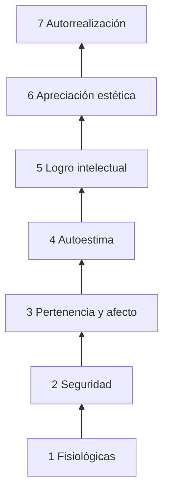

# Tema 6 · Motivación en el proceso de enseñanza-aprendizaje

**Asignatura:** Psicología del desarrollo y de la educación  
**Programa:** [tema 6](../programa.md)  
**Correspondencia con los apuntes oficiales:** *Bloque I · Tema 2 — Motivación* (presentación **2.1**, orientada a metas, condiciones y diseño motivacional, y presentación **2.2**, orientada a concepto, teorías y motivación intrínseca/extrínseca).

**Viene de:** [Tema 4 — Cognición](04-procesamiento-informacion-teorias-cognitivas.md) · [Tema 3 — Conducta](03-teorias-conductuales-modificacion-conducta.md) · [Tema 2 — Diferencias](02-diferencias-individuales-problemas-adolescencia.md) · [Tema 1 — Desarrollo](01-desarrollo-adolescencia.md)

> Cierra el bloque de la asignatura: con el mapa del adolescente (1–2), la gestión de conducta (3) y el diseño cognitivo de tareas (4), este tema pregunta **por qué se inicia, se dirige y se sostiene** el esfuerzo por aprender Matemáticas.

> **Cómo está organizado.** El apunte integra (a) los contenidos de las presentaciones oficiales de la asignatura —marcados con **📘 Oficial**— y (b) el desarrollo propio del repositorio (SDT, expectativa–valor–coste, Dweck, Hattie y Timperley, autorregulación, ejemplos de Matemáticas). Cuando ambos coinciden se han fusionado; cuando no, conviven con etiqueta.

---

## Por dónde leer (mapa del tema)

| Paso | Recurso | Para qué |
|------|---------|----------|
| **1** | Este apunte | Marcos de motivación, metas, SDT, atribuciones, diseño motivacional, refuerzos, feedback |
| **2** | [Autoeficacia matemática](../materiales/autoeficacia-matematica.md) | Fuentes de Bandura; logros de dominio |
| **3** | [Mindset y atribuciones](../materiales/mindset-atribuciones-matematicas.md) | Weiner, Dweck; frases de feedback |
| **4** | [Feedback efectivo](../materiales/feedback-efectivo-matematicas.md) | Niveles Hattie y Timperley |
| **5** | [Gestión del error](../materiales/gestion-del-error-matematicas.md) | Error como información |
| **6** | [Ansiedad matemática](../materiales/ansiedad-matematica-aula.md) | Evitación y memoria de trabajo |
| **7** | [Tema 4](04-procesamiento-informacion-teorias-cognitivas.md) | Tarea mal dimensionada → “desmotivación” aparente |
| **8** | Optativa Educación emocional | Clima y regulación (sin duplicar aquí su temario) |
| **0** | [Introducción a la Psicología de la Educación](../materiales/introduccion-psicologia-educacion-justificacion-casos.md) | Fuentes, bloques de contenido, justificación de la disciplina |

### Mapa: presentaciones oficiales → apartados de este apunte

| Contenido oficial | Presentación | Apartado |
|-------------------|:------------:|----------|
| Fracaso escolar y variables del aprendizaje | 2.2 | [§1](#1-variables-del-aprendizaje-y-fracaso-escolar) |
| Concepto de motivación; poder y querer; caso Terry Fox; explicaciones conductistas y cognitivas | 2.2 | [§2](#2-qué-es-la-motivación) |
| Relación bidireccional motivación–aprendizaje | 2.1 | [§2.5](#25-relación-bidireccional-motivación--aprendizaje) |
| Motivación intrínseca y extrínseca; Bruner | 2.2 / 2.1 | [§3](#3-motivación-intrínseca-y-extrínseca) |
| Maslow; motivación de logro (McClelland, Atkinson); atribución (Weiner) | 2.2 | [§4](#4-teorías-clásicas-de-la-motivación) |
| Metas, orientaciones, efectos de cada meta, evaluación de la motivación | 2.1 | [§5](#5-metas-y-orientaciones-motivacionales) |
| Condiciones de la motivación intrínseca (autonomía y competencia) | 2.1 | [§6](#6-teoría-de-la-autodeterminación-deci-y-ryan) |
| Atención, empatía, interés y utilidad | 2.1 | [§9](#9-factores-del-aula-atención-empatía-interés-y-utilidad) |
| Principios de diseño motivacional; estrategias de estimulación | 2.1 / 2.2 | [§10](#10-diseño-motivacional-de-la-instrucción) |
| Reforzadores en el aula | 2.1 | [§11](#11-refuerzos-en-el-aula) |
| Clase interactiva | 2.1 | [§12](#12-estrategias-para-una-clase-interactiva) |
| Conclusiones | 2.2 | [§17](#17-conclusiones-del-tema) |

---
## 0. Psicología de la Educación: fuentes y bloques de contenido

Antes de centrarnos en la motivación, conviene situar este tema dentro del marco más amplio de la **Psicología de la Educación**. Esta disciplina no es un catálogo de “trucos motivacionales”, sino el estudio científico de los procesos de aprendizaje y enseñanza, de las variables del alumnado y del diseño de condiciones que facilitan el desarrollo y el logro.

### 0.1. Las cuatro fuentes de la Psicología de la Educación

La Psicología de la Educación se nutre de (y dialoga con) cuatro grandes áreas de la psicología:

| Fuente | Aporta al docente de Matemáticas | Enlaces en el repositorio |
|--------|----------------------------------|---------------------------|
| **Psicología del aprendizaje** | Cómo se adquieren, retienen, recuperan y transfieren conocimientos y hábitos; papel de la práctica, la memoria y el feedback | [Tema 3 · Conductuales](03-teorias-conductuales-modificacion-conducta.md) · [Tema 4 · Cognición](04-procesamiento-informacion-teorias-cognitivas.md) · [Carga cognitiva](../materiales/carga-cognitiva-matematicas.md) · [Memoria, práctica y transferencia](../materiales/memoria-practica-transferencia-matematicas.md) · [Técnicas de estudio basadas en evidencia](../materiales/tecnicas-estudio-basadas-en-evidencia.md) |
| **Psicología del desarrollo** | Capacidades, necesidades y ritmos de la adolescencia; cambios cognitivos, emocionales y sociales | [Tema 1 · Adolescencia](01-desarrollo-adolescencia.md) · [Tema 2 · Diferencias](02-diferencias-individuales-problemas-adolescencia.md) · [Desarrollo moral (Kohlberg)](../materiales/desarrollo-moral-kohlberg-aula.md) |
| **Psicología de la personalidad** | Diferencias individuales, autoconcepto, autoestima, autoeficacia, estilos y rasgos que modulan el aprendizaje | [Autoeficacia matemática](../materiales/autoeficacia-matematica.md) · [Mindset y atribuciones](../materiales/mindset-atribuciones-matematicas.md) · [Ansiedad matemática](../materiales/ansiedad-matematica-aula.md) · [Neurodivergencia](../materiales/neurodivergencia-aula-matematicas.md) · [Discalculia y DEA](../materiales/discalculia-y-dea-matematicas.md) |
| **Psicología social** | Grupo, normas, status, influencia de los iguales, clima de aula y procesos de influencia social | [Tema 1 · Pares y autonomía](01-desarrollo-adolescencia.md) · [Haidt / RRSS y atención](../materiales/haidt-redes-atencion-adolescencia.md) · [Registro ABC](../materiales/registro-abc-conducta.md) (contexto social de la conducta) |

**Lectura docente:** la motivación (este tema) es el punto de encuentro de las cuatro fuentes. Un alumno “desmotivado” puede estarlo por una tarea mal dimensionada (aprendizaje/cognición), por una fase evolutiva de alta sensibilidad al ridículo (desarrollo), por una autoeficacia baja o atribuciones fijas (personalidad), o por presión del grupo y clima de evitación (social). Diagnosticar con una sola lente suele empujar a intervenciones incompletas.

### 0.2. Los cuatro bloques de contenido de la Psicología de la Educación

Los contenidos nucleares de la disciplina se organizan, de forma sintética, en cuatro bloques que el docente de Matemáticas recorre continuamente:

| Bloque | Pregunta central | Traducción al aula de Matemáticas | Materiales relacionados |
|--------|------------------|-----------------------------------|-------------------------|
| **1. Naturaleza del aprendizaje** | ¿En qué consiste aprender y cómo se produce? | Adquisición, retención, recuperación y transferencia de procedimientos, conceptos y estrategias | [Tema 3](03-teorias-conductuales-modificacion-conducta.md) · [Tema 4](04-procesamiento-informacion-teorias-cognitivas.md) · [Memoria y práctica](../materiales/memoria-practica-transferencia-matematicas.md) · [Técnicas de estudio](../materiales/tecnicas-estudio-basadas-en-evidencia.md) |
| **2. Variables del alumnado** | ¿Qué características del estudiante influyen en el aprendizaje? | Conocimientos previos, capacidad, etapa evolutiva, motivación, autoconcepto/autoeficacia, ansiedad, diferencias individuales | [Tema 1](01-desarrollo-adolescencia.md) · [Tema 2](02-diferencias-individuales-problemas-adolescencia.md) · [Autoeficacia](../materiales/autoeficacia-matematica.md) · [Mindset](../materiales/mindset-atribuciones-matematicas.md) · [Ansiedad matemática](../materiales/ansiedad-matematica-aula.md) · [Neurodivergencia](../materiales/neurodivergencia-aula-matematicas.md) · [Discalculia](../materiales/discalculia-y-dea-matematicas.md) |
| **3. Resultados de aprendizaje** | ¿Qué se pretende que el alumnado sepa, sepa hacer y valore? | Objetivos, competencias, criterios de evaluación; distinguir rendimiento inmediato de aprendizaje duradero y transferencia | [Tema 4](04-procesamiento-informacion-teorias-cognitivas.md) · [Diseño de tareas multinivel](../materiales/diseno-tareas-multinivel-matematicas.md) · [Evidencia en psicología educativa](../materiales/evidencia-psicologia-educativa.md) |
| **4. Planificación de la enseñanza y diseño de tareas** | ¿Cómo se diseña la instrucción para maximizar el aprendizaje? | Secuenciación, andamiaje, carga cognitiva, feedback, evaluación formativa, clima y estructura motivacional del aula | [ZDP y andamiaje](../materiales/zdp-andamiaje-matematicas.md) · [Carga cognitiva](../materiales/carga-cognitiva-matematicas.md) · [Funciones ejecutivas](../materiales/funciones-ejecutivas-matematicas.md) · [Feedback efectivo](../materiales/feedback-efectivo-matematicas.md) · [Gestión del error](../materiales/gestion-del-error-matematicas.md) · [Diseño multinivel](../materiales/diseno-tareas-multinivel-matematicas.md) |

**Puente con este tema:** la motivación no es un “añadido” al final de la planificación. Forma parte del **bloque 2** (variables del alumnado) y del **bloque 4** (diseño de condiciones que sostienen el esfuerzo). Un diseño de tareas que ignore la autoeficacia, las metas o el coste social produce “desmotivación” aparente aunque el contenido sea correcto.

→ Marco completo y justificación histórica: **[Introducción a la Psicología de la Educación](../materiales/introduccion-psicologia-educacion-justificacion-casos.md)**

---

## 1. Variables del aprendizaje y fracaso escolar

> 📘 **Oficial** · Bloque I · Tema 2.2 (Introducción y «Variables del aprendizaje»).

Sería de esperar que, en una escolaridad normal y con alumnado «sin dificultades», el aprendizaje fuera eficaz en su mayoría. No es así: las presentaciones oficiales recuerdan que las cifras de **bajo rendimiento y fracaso escolar** aumentan progresivamente de la Primaria a la Secundaria y llegan a niveles muy altos en la universidad (la diapositiva cita un 50 %; conviene contrastar el dato con una fuente actualizada antes de citarlo en un trabajo).

**¿A qué se debe?** Tradicionalmente se pensaba que el aprendizaje dependía solo de la **capacidad intelectual**. Hoy se sabe que la inteligencia, aunque importante, es **una variable más** entre muchas. De todas ellas, este tema se centra en la **motivación**.

### 1.1. Variables que influyen en el aprendizaje (Sampascual, 2007)

| Grupo | Subgrupo | Variables |
|-------|----------|-----------|
| **1. Sujeto que aprende** | Cognitivas | Conocimientos previos · capacidad intelectual · estilo cognitivo |
| | Motivacionales | Motivación · autoconcepto |
| **2. Contenido que se aprende** | — | Naturaleza y estructura del contenido · organizadores previos · explicitación de objetivos · introducciones, títulos, resúmenes y esquemas · organizadores gráficos |
| **3. Cómo se aprende** | Metodológicas (profesor) | Planificación y actuación: objetivos, contenidos, recursos, metodología, evaluación, reforzadores |
| | Metodológicas (alumno) | Estrategias de aprendizaje |
| | Contextuales | Clima del aula · interacción entre alumnos · interacción profesor–alumno · familia y contexto social |

**Lectura para Matemáticas:** un mismo bajo rendimiento puede venir de conocimientos previos insuficientes (cognitiva), de un contenido mal estructurado (contenido), de una metodología sin andamiaje (profesor), de estrategias pobres (alumno) o de un clima de evitación (contextual). La motivación **atraviesa** todas ellas. Esta tabla complementa los cuatro bloques de contenido del §0.2 (variables del alumnado y planificación de la enseñanza).

---
## 2. ¿Qué es la motivación?

Conjunto de procesos que **inician, dirigen y sostienen** la conducta hacia metas. En el aula interesa menos la etiqueta «motivado / no motivado» y más **qué condiciones** hacen más probable el esfuerzo, la persistencia y la búsqueda de comprensión.

### 2.1. Indicadores observables en Matemáticas

| Indicador | Señal positiva | Señal de riesgo |
|-----------|----------------|-----------------|
| Participación | Pregunta, explica, prueba | Silencio sistemático, “paso” |
| Persistencia | Reintenta tras el error | Abandono al primer fallo |
| Uso del tiempo | Practica con foco | Evita empezar; rellena sin pensar |
| Respuesta al feedback | Ajusta la estrategia | Ignora o se cierra |
| Exposición | Acepta explicar el razonamiento | Miedo extremo a la pizarra |

### 2.2. Motivación ≠ entretenimiento

Puede haber alta “animación” y baja exigencia cognitiva, o alta exigencia y buena motivación de dominio. El objetivo no es que la clase sea un espectáculo, sino que el alumnado **quiera y pueda** esforzarse en tareas que merecen la pena.

### 2.3. Poder y querer: dos condiciones del aprendizaje eficaz

> 📘 **Oficial** · Bloque I · Tema 2.2 («Concepto»).

Ni los reflejos ni las conductas aprendidas se ponen en marcha si no existe motivación para ello. De ahí que la motivación sea un factor determinante en cualquier actividad humana: es la **fuerza que impulsa y orienta la actividad** de una persona hacia un objetivo. Para el aprendizaje, la presentación oficial distingue dos condiciones:

| Condición | Lo aporta | Papel |
|-----------|-----------|-------|
| **Poder** | Capacidades intelectuales y variables cognitivas | Potencial para aprender algo |
| **Querer** | Motivación | Activación, dirección y persistencia de la conducta |

Un alumno puede disponer de conocimientos y capacidad adecuados y, aun así, **no iniciar** el proceso de aprendizaje: hace falta ponerlo en marcha. Sin motivación no hay aprendizaje, porque ella determina el **esfuerzo** que se dedica.

**Caso Terry Fox (actividad de aula).** La presentación proyecta el vídeo de Terry Fox ([ver vídeo](https://youtu.be/6RH_Ds6-mwI)) y plantea tres preguntas: ¿estaba motivado?, ¿en qué se nota?, ¿por qué hizo esa carrera? La lectura propuesta es que su motivación fue dar **propósito** a su vida ayudando a otras personas con cáncer, y que su conducta fue **energética, dirigida y sostenida**: las tres funciones de la motivación.

### 2.4. Dos tipos de explicaciones de la motivación

> 📘 **Oficial** · Bloque I · Tema 2.2.

| | Explicaciones **conductistas** | Explicaciones **cognitivas** |
|--|-------------------------------|------------------------------|
| Qué es la motivación | Proceso que impulsa la conducta para obtener **incentivos** | Resultado de **procesos mentales** que median entre estímulos y respuestas |
| Mecanismo | La obtención del incentivo asocia situaciones y estímulos con respuestas (condicionamiento) | No hay determinación automática por el refuerzo |
| Origen | **Extrínseca**: recompensas e incentivos externos | **Intrínseca**: motivos, intereses, expectativas, atribuciones, metas… |
| En el aula | Incentivos materiales (calificaciones, puntos), sociales (reconocimiento, aprobación, afecto) y de actividad (juegos, viajes) | Se puede actuar sin incentivo externo (p. ej. un profesor vocacional) |

Ambas explicaciones se complementan: la primera enlaza con el [Tema 3](03-teorias-conductuales-modificacion-conducta.md) (refuerzo) y la segunda con el [Tema 4](04-procesamiento-informacion-teorias-cognitivas.md) y con este tema (metas, expectativas, atribuciones).

### 2.5. Relación bidireccional motivación ↔ aprendizaje

> 📘 **Oficial** · Bloque I · Tema 2.1.

La influencia entre motivación y aprendizaje es **bidireccional**:

- intervenir en **estrategias de aprendizaje** favorece tanto el aprendizaje como la motivación;
- la motivación influye no solo en *cuánto* se aprende, sino en la **calidad del procesamiento** de la información y en el uso de estrategias;
- y, como recuerdan las conclusiones oficiales (§17), la motivación **también es un resultado** del aprendizaje: quien no aprende acaba sin motivación por aprender.

**Implicación:** enseñar estrategias (Tema 4, [técnicas de estudio](../materiales/tecnicas-estudio-basadas-en-evidencia.md)) es también una intervención motivacional.

---
## 3. Motivación intrínseca y extrínseca

| Tipo | Definición | Ejemplo en mates |
|------|------------|------------------|
| **Intrínseca** | La actividad se hace por interés o satisfacción de comprender | Probar otra estrategia porque “quiero ver si sale” |
| **Extrínseca** | Por notas, premios, evitar castigo o aprobación | Estudiar solo la noche del examen por la nota |

Ambas pueden **coexistir**. La extrínseca no es “mala” por definición: puede arrancar un hábito o sostener el esfuerzo en fases difíciles. El riesgo es el **desplazamiento**: que la recompensa externa acabe sustituyendo el interés por entender.

**Lectura docente:** las notas y los reconocimientos existen; el diseño del aula decide si empujan solo a “aprobar el trámite” o también a “dominar el procedimiento”.

### 3.1. Evidencia y límites en el aula

> 📘 **Oficial** · Bloque I · Tema 2.2.

- El rendimiento de los alumnos tiende a ser **superior** cuando la motivación es intrínseca.
- En el aula **no siempre es posible** que trabajen motivados de forma intrínseca: en determinadas tareas y con los alumnos más pequeños será necesario emplear **reforzadores externos** (véase [§11](#11-refuerzos-en-el-aula)).
- Progresivamente debe intentarse que la motivación **se mantenga de forma interna** (hilo del §14: control externo → regulación interna → autonomía).

| Meta | Se realiza la tarea… |
|------|----------------------|
| **Externa** | para conseguir una recompensa o evitar un castigo |
| **Interna** | por una iniciativa inherente y natural a la propia persona |

### 3.2. Dos motivos innatos internos (Bruner)

> 📘 **Oficial** · Bloque I · Tema 2.2.

Según Bruner, es posible orientar hacia lo interno porque existen dos motivos innatos de tipo interno:

| Motivo | Cuándo aparece | Rasgo |
|--------|----------------|-------|
| **Curiosidad** | Desde los primeros años, de forma automática, ante situaciones con **varias respuestas posibles** | Impulsa la búsqueda de información y la solución del problema |
| **Competencia** | Desde los ~9 meses; se observa como una sonrisa de satisfacción («sonrisa maestra») al culminar una tarea | Presupone una sensación interna de orgullo |

**Eco en Matemáticas:** problemas con más de una vía de resolución (curiosidad) y tareas que se pueden *terminar* con éxito visible (competencia) activan estos motivos; conecta con los «logros de dominio» de la [autoeficacia](../materiales/autoeficacia-matematica.md).

---
## 4. Teorías clásicas de la motivación

> 📘 **Oficial** · Bloque I · Tema 2.2 («Teorías de la motivación»: Maslow, motivación de logro, atribución). Se complementan con la teoría de la autodeterminación (§6) y expectativa–valor–coste (§7), propias del repositorio.

### 4.1. Maslow (con cautela)

**Marco oficial.** Maslow se encuadra en las perspectivas **humanistas**: los individuos se caracterizan por una personalidad diferencial que los impulsa, dentro de su libertad personal, hacia la **autorrealización** y la **autodeterminación**; buscan de forma innata desarrollar todo su potencial. Para llegar a ella necesitan satisfacer **siete necesidades**, jerarquizadas en dos sentidos: por el **orden de aparición** a lo largo del desarrollo y porque las de nivel superior **no aparecen** hasta que se satisfacen las inferiores.

| Nivel | Necesidad | Contenido | Grupo |
|:-----:|-----------|-----------|-------|
| 1 | **Fisiológicas** | Hambre, sed, sueño… | Deficiencia |
| 2 | **Seguridad** | Estar libre de peligros físicos y psicológicos (más evidente en niños) | Deficiencia |
| 3 | **Pertenencia y afecto** | Integración y afecto en un grupo social, familia…; si se frustran con frecuencia, dan lugar a desequilibrios psicológicos | Deficiencia |
| 4 | **Autoestima** | Imagen positiva de uno mismo por la aprobación y el reconocimiento ajenos; su no satisfacción produce inferioridad, fracaso, inactividad y abandono | Deficiencia |
| 5 | **Logro intelectual** | Curiosidad, comprender y conocer el mundo; no aparece con tanta claridad en todos | Ser |
| 6 | **Apreciación estética** | Búsqueda de orden, belleza, simetría, terminación de lo emprendido (la menos clara) | Ser |
| 7 | **Autorrealización** | Llegar a ser lo que uno es capaz de ser; no aparece en jóvenes, requiere identidad personal y sistema estable de valores | Ser |



*Figura. Los niveles 1–4 son necesidades de **deficiencia**; 5–7, necesidades de **ser**.*

- **Necesidades de deficiencia** (las cuatro más bajas): no dejan espacio a las superiores hasta que se satisfacen, pero **desaparecen una vez satisfechas**.
- **Necesidades de ser:** **no se extinguen** cuando se atienden; al contrario, aumentan.
- Según la presentación, la mayoría de las personas **no llega a la autorrealización**: su desarrollo se detiene al alcanzar la autoestima.

**Críticas.** Los seres humanos no siempre se comportan como el modelo predice (alguien puede sentir curiosidad por conocer sin tener cubierta su necesidad de afecto).

**Implicaciones para el alumnado (oficial).** No cabe esperar motivación por aprender cuando no están cubiertas las necesidades fisiológicas, o cuando el alumno se siente inseguro, no querido, sin confianza o poco aceptado. Esto ayuda a explicar por qué el alumnado procedente de **entornos pobres o abusivos** tiene, en conjunto, menor probabilidad de logro académico (tendencia estadística, no destino individual).

**Lectura prudente del repositorio.**

La jerarquía de necesidades recuerda que **sueño, seguridad y pertenencia** condicionan el aprendizaje. Un alumno que no duerme, que teme el aula o que se siente excluido tiene menos recursos para el esfuerzo cognitivo.

**No** es un modelo causal rígido ni una pirámide que explique cada desmotivación académica. Úsalo como recordatorio de condiciones de base, no como diagnóstico de pasillo.

### 4.2. Motivación de logro (McClelland y Atkinson)

Orientación a **tener éxito** y a evitar el fracaso. Interactúa con la dificultad percibida, con la autoeficacia y con las atribuciones (§4.3 y §8).

> 📘 **Oficial** · Bloque I · Tema 2.2.

**Definición.** McClelland y Atkinson figuran entre los primeros en estudiarla: es la **necesidad de superar tareas difíciles**, dar lo mejor de uno mismo, alcanzar metas altas y destacar sobre los demás. En el aula se observan alumnos que, en igualdad de condiciones, se esfuerzan por grandes logros y otros que no.

**Modelo de McClelland.** En la motivación intervienen dos factores:

| Factor | Naturaleza | Significado |
|--------|-----------|-------------|
| **Expectativa** | Cognitivo | Esperanza de conseguir el objetivo |
| **Valor del incentivo** | Emocional | Valor que tiene el objetivo |

Si ambos son **positivos**, aparece conducta de **aproximación**; si son **negativos**, de **evitación**. (Ejemplo oficial: quien prepara oposiciones estudia si cree que puede aprobar *y* el puesto le resulta atractivo; no estudia si cree que no aprobará o el puesto no le atrae.)

**Modelo de Atkinson.** Todas las personas tienen dos tendencias: **motivación para lograr el éxito (Me)** y **motivación para evitar el fracaso (Mf)**. La motivación de logro es la **suma** de ambas:

```text
Motivación de logro = Motivación de éxito (Me) + Motivación de evitar el fracaso (Mf)
```

Difieren en su disposición a afrontar el riesgo:

| Perfil | Tareas que prefiere | Ante el fracaso / el éxito |
|--------|--------------------|-----------------------------|
| **Me > Mf** | Dificultad **intermedia** (rechaza las muy fáciles y las muy difíciles) | El fracaso **aumenta** su motivación; el éxito la **disminuye** |
| **Me < Mf** | Dificultad **extrema** (muy alta o muy baja) | **Abandona** ante el fracaso; el éxito le **estimula** a volver a intentarlo |

**Origen familiar.** Los estudios citados en la presentación indican que la motivación de logro **se aprende** en el ambiente familiar en la infancia temprana: padres que fomentan que el niño se valga por sí mismo (ordenar la ropa, recoger juguetes) frente a padres que obstaculizan la independencia; que proponen niveles de aspiración elevados; que refuerzan mediante afecto y elogio y critican más cuando la conducta es inadecuada; y que refuerzan el **esfuerzo** en lugar de ignorarlo o criticar el fracaso.

**Eco en Matemáticas.** Un alumno Me < Mf puede elegir siempre el ejercicio trivial o el reto imposible (ambos «protegen» de fallar donde importa). Tareas **graduadas de dificultad intermedia**, con reintento formativo, son lo más compatible con ambos perfiles. Es un marco de tendencias, **no una etiqueta** de personalidad.

### 4.3. Atribuciones (Weiner)

Causas percibidas del éxito/fracaso según **locus** (interno/externo), **estabilidad** y **controlabilidad**.

| Atribución del fracaso | Efecto probable |
|------------------------|-----------------|
| Capacidad fija (“no sirvo”) | Indefensión, evitación |
| Estrategia inadecuada | Apertura a aprender |
| Esfuerzo insuficiente (realista) | Puede motivar si se planifica |
| “El examen era imposible” (externa estable) | Desresponsabilización |

El **desamparo aprendido** aparece cuando el alumno atribuye el fracaso a una incapacidad **estable e incontrolable**.

**Objetivo docente:** orientar hacia factores **internos, inestables y controlables** (esfuerzo + estrategia).

> 📘 **Oficial** · Bloque I · Tema 2.2 («Teoría de la atribución»).

Weiner (1974), dentro de la teoría de la motivación de logro, estudió los **efectos motivacionales** de las experiencias de éxito y fracaso: ante ellas buscamos **causas** (atribuciones: explicaciones causales de la conducta propia y ajena). Cada causa se ubica en tres dimensiones, con consecuencias emocionales y expectativas distintas (Sampascual, 2007):

| Dimensión | Polo y ejemplos de causas | Consecuencias |
|-----------|---------------------------|---------------|
| **1. Locus de causalidad** | **Interno** (capacidad, esfuerzo) | Éxito: autosatisfacción y orgullo · Fracaso: culpa y vergüenza |
| | **Externo** (suerte, dificultad de la tarea, exigencias del profesor) | Éxito: gratitud · Fracaso: irritación |
| **2. Estabilidad** | **Estable** (capacidad, dificultad de la tarea) | Éxito y fracaso: expectativas similares en tareas similares |
| | **Inestable** (suerte, esfuerzo) | Éxito y fracaso: expectativa de que en el futuro puede haber cambios |
| **3. Controlabilidad** | **Controlable** (esfuerzo, estrategias) | Éxito: expectativa de que se repita · Fracaso: culpabilidad y expectativa de cambio |
| | **Incontrolable** (capacidad, suerte, exigencias, dificultad) | Éxito: sentirse afortunado, expectativas inciertas · Fracaso: sentirse deprimido e incompetente, expectativas semejantes |

- **Situación más positiva:** atribuir el **éxito** a causas **internas, inestables y controlables**.
- **Situación más negativa:** atribuir el **fracaso** a causas **internas, estables e incontrolables** (→ desamparo aprendido, ya visto).
- Las causas a las que el alumnado atribuye con más frecuencia sus éxitos y fracasos son la **capacidad** y el **esfuerzo**.

**Dos casos oficiales (Santrock) para analizar:**

| | **Jane** | **Susan** |
|--|----------|-----------|
| Suspende Matemáticas y… | se lo atribuye a sí misma, sin culpar al profesor ni a la suerte, y a la **falta de preparación y tiempo de estudio** | lo atribuye a **falta de capacidad** |
| Dimensiones | Interna · inestable · controlable | Interna · estable · incontrolable |
| Emoción y expectativa | Culpa; expectativas razonables de éxito futuro; la autoestima no se hunde | Autoestima dañada, indefensión, vergüenza, sentimiento de incompetencia |
| Qué ocurre después | Renueva metas, aumenta la motivación y estudia más (pide tutoría) | Sus padres y profesor lo lamentan **sin ofrecer estrategia**; baja autoestima y ánimo; **abandona** la escuela en lugar de estudiar más |

**Moraleja docente:** ante el mismo suspenso, lo decisivo no es el resultado sino **la causa percibida** y **la ayuda recibida**. Ofrecer una estrategia concreta (en lugar de solo «lo siento») cambia la dimensión de controlabilidad. Material: [Mindset y atribuciones](../materiales/mindset-atribuciones-matematicas.md).

---
## 5. Metas y orientaciones motivacionales

> 📘 **Oficial** · Bloque I · Tema 2.1 (Alonso Tapia).

La presentación sitúa la motivación «**aquí y ahora**» en dos componentes: las **expectativas de autoeficacia** (la convicción de poder realizar con éxito la conducta o tarea necesaria para lograr un resultado; véase §7 y §8) y las **metas** (las *razones* para realizar la conducta o la tarea).

### 5.1. Metas de aprendizaje vs. metas de rendimiento

| Meta | Centro | Efecto típico en mates |
|------|--------|-------------------------|
| **Aprendizaje / dominio** | Comprender, mejorar | Mayor persistencia; uso del error como información |
| **Rendimiento (aproximación)** | Quedar bien, ser el mejor | Puede empujar esfuerzo, pero frágil ante el fallo público |
| **Rendimiento (evitación)** | No quedar mal, no parecer “tonto” | Evitación de retos; miedo a la pizarra; mínimo esfuerzo visible |

En la **adolescencia media** (Tema 1) el peso del grupo hace especialmente costosas las metas de evitación: el ridículo social pesa más que en otras etapas.

**Diseño:** criterios claros, reintentos formativos y feedback de proceso empujan hacia metas de dominio; rankings públicos y sarcasmo empujan hacia evitación.

> 📘 **Oficial.** Las **metas de aprendizaje** se centran en ampliar conocimientos y capacidad; las **metas de rendimiento**, en demostrar la competencia adquirida **en comparación con otros** o alcanzar un estándar marcado.

### 5.2. Las metas según Alonso Tapia (1992, 1997)

Todo el conjunto de metas está presente, o puede estarlo, en **todos** los alumnos; lo que varía es la **intensidad** con que cada una influye en cómo se afronta la tarea (Alonso Tapia, 1997). Se agrupan así (Alonso Tapia, 1992):

| Meta (deseo o necesidad) | Grupo de metas |
|--------------------------|----------------|
| Deseo de **dominio** y experiencia de competencia | Relacionadas con la **tarea** (motivación **intrínseca**) |
| Deseo de aprender algo **útil** | Relacionadas con la **tarea** (motivación **intrínseca**) |
| Deseo de conseguir **recompensas** | Obtención de recompensas externas (motivación **extrínseca**) |
| Necesidad de **seguridad** que da el aprobado | Obtención de recompensas externas (motivación **extrínseca**) |
| Necesidad de preservar la **autoestima** | Relacionadas con la **autovaloración del yo** |
| Necesidad de **autonomía** y control personal | Relacionadas con la **libertad de elección** |
| Necesidad de **aceptación** incondicional | Relacionadas con la **valoración social** |

**Otros enfoques equivalentes (misma presentación).** Se habla también de **orientación al aprendizaje** (cercana a la motivación intrínseca), **orientación al resultado** (cercana a la extrínseca) y **orientación a la evitación**. La orientación a la evitación enlaza con las metas de rendimiento de evitación del §5.1.

### 5.3. Efectos de perseguir cada tipo de meta (Alonso Tapia, 1997, cuadro 3)

El signo **+** indica efecto favorable para la motivación y el aprendizaje; **−**, desfavorable.

| Meta | Efectos | Valor |
|------|---------|:-----:|
| **Dominio y competencia** | Inmersión en la tarea (estar absortos) · búsqueda de la ayuda realmente necesaria · elaboración del conocimiento · búsqueda de información | + |
| **Que lo aprendido sea útil** | Si falta funcionalidad: se **elimina** el interés y la motivación por aprender y aumenta la sensación de obligación | − |
| **Conseguir recompensas** | Favorece la motivación si el interés inicial es muy bajo, si disfrutar requiere experimentar la tarea o si disfrutar requiere cierta destreza | + |
| | En los demás casos **perjudica** la motivación intrínseca | − |
| **Seguridad del aprobado** (amenaza de notas desfavorables) | Aumenta las tareas terminadas; induce más aprendizaje memorístico; según la evaluación, las notas mejoran | + |
| | Puede llegar a perjudicar la comprensión y el aprendizaje significativo | − |
| **Preservar la autoestima** | Inhibe preguntar y participar; tiende a inducir formas inadecuadas de estudio | − |
| | Si hay segunda oportunidad, el esfuerzo por aprobar aumenta | + |
| **Autonomía y control personal** | *Sentimiento de obligación*: destruye el interés, elimina el esfuerzo, favorece conductas para «salir de la situación» | − |
| | *Sentimiento de autonomía*: lleva a buscar medios alternativos de aprender | + |
| **Aceptación personal incondicional** | *Sentimiento de rechazo*: provoca rechazo de lo escolar y aumenta la sensación de obligación | − |
| | *Deseo de aceptación*: induce a aceptar los valores de los otros significativos | +/− |

**Lectura para Matemáticas.** La tabla respalda decisiones concretas: **reintento formativo** (la segunda oportunidad convierte la amenaza a la autoestima en esfuerzo), **utilidad explícita** de cada bloque, **elección** dentro de la estructura y **clima de aceptación** del alumno, no solo de sus resultados. El cuadro ilustra, además, por qué la meta «aprobar» puede mejorar notas y a la vez **empeorar la comprensión** si no se acompaña de tareas con sentido.

### 5.4. Cómo evaluar la motivación en el aula

> 📘 **Oficial** · Bloque I · Tema 2.1.

La evaluación puede ser **individual o grupal** y combinar:

| Procedimiento | Qué recoge |
|---------------|-----------|
| **Entrevistas** | Metas, creencias, razones declaradas |
| **Observación** | Mensajes del alumnado, metas que se infieren, preguntas que hace… |
| **Cuestionarios** | Escala de orientación intrínseca vs. extrínseca hacia el aprendizaje en el aula (original de Harter, 1985; con adaptación española) · cuestionarios **MAPE-I** y **MAPE-II** (Alonso Tapia y Sánchez, 1992), entre otros |

Para el practicum, la observación estructurada del §19 es el camino más viable.

---
## 6. Teoría de la autodeterminación (Deci y Ryan)

Tres necesidades psicológicas básicas que, cuando se satisfacen, favorecen motivación de calidad y bienestar:

| Necesidad | Pregunta del alumno | Traducción en el aula de mates |
|-----------|---------------------|--------------------------------|
| **Autonomía** | “¿Tengo voz en el proceso?” | Elección entre problemas equivalentes; justificar un método; no solo obediencia ciega |
| **Competencia** | “¿Puedo progresar?” | Retos alcanzables; feedback de proceso; evidencia de mejora |
| **Relación (vinculación)** | “¿Me respetan aquí?” | Clima de respeto; error no ridiculizado; cooperación real |

**Autonomía no es permisividad:** es percibir que las acciones tienen sentido y agencia dentro de una estructura clara. **Competencia no es “todo fácil”:** es reto con apoyo (ZDP, Tema 4).

### 6.1. Condiciones que facilitan la motivación intrínseca en el aula: autonomía y competencia

> 📘 **Oficial** · Bloque I · Tema 2.1.

La presentación oficial destaca dos condiciones, que coinciden con dos de las tres necesidades de la SDT:

**Autonomía.** El **sentimiento de obligación** deteriora la motivación intrínseca; el **sentimiento de libertad** la favorece. Pero el sistema educativo impone autoridad del profesor, currículum establecido, programaciones… **¿Qué puede hacer el profesor?** Ampliar la **optatividad**, las alternativas y las opciones de elección, y ayudar al alumnado a **tomar conciencia de sus propios gustos y motivaciones**.

**Competencia.** Se trata de la **expectativa de autoeficacia** y de la **competencia percibida**. No consiste en recibir solo juicios positivos, sino en que **el propio alumno se perciba como competente** (autoconcepto y autoestima). **¿Qué puede hacer el profesor?** Evitar mensajes de crítica, ofrecer **oportunidades de éxito** y prestar atención a las **atribuciones** de éxito y fracaso (§4.3).

---
## 7. Expectativa, valor y coste

Además de metas y autoeficacia, la persistencia depende de tres juicios del alumno:

| Componente | Pregunta | Si falla… |
|------------|----------|-----------|
| **Expectativa de éxito** | “¿Puedo hacerlo?” | Evitación o abandono temprano |
| **Valor** | “¿Me importa / me sirve / me identifica?” | “¿Para qué?” aunque sepa que podría |
| **Coste** | “¿Cuánto esfuerzo, tiempo o riesgo social me pide?” | El coste supera el valor percibido |

Dos alumnos pueden juzgar *igual de difícil* el mismo problema: uno persevera porque lo ve **útil y alcanzable**; otro abandona porque el **coste** (esfuerzo + miedo al ridículo) no compensa.

**Implicación:** explicar el *para qué* de un bloque (valor de utilidad), graduar el reto (expectativa) y bajar el riesgo social innecesario (coste) son intervenciones motivacionales concretas, no “charlas de ánimo”.

> 📘 **Oficial.** Este esquema desarrolla el componente «expectativas de autoeficacia + metas» de la presentación 2.1 (§5): la **expectativa** corresponde a la autoeficacia, y el **valor** y el **coste** a las metas y a su utilidad percibida (véase §9, *Utilidad*).

---
## 8. Autoconcepto, autoestima, autoeficacia y mindset

*(Las atribuciones de Weiner se desarrollan ahora en el §4.3.)*

### 8.1. Tres conceptos que no se confunden

| Concepto | Foco |
|----------|------|
| **Autoconcepto** | “¿Cómo me veo en mates en general?” |
| **Autoestima** | Valoración afectiva global de uno mismo |
| **Autoeficacia** | “¿Puedo ejecutar *esta* tarea / este tipo de problemas?” (Bandura) |

La autoeficacia es **específica de dominio y de tarea**. Se construye sobre todo con **logros de dominio** bien dosificados, modelado creíble, persuasión verbal ligada a la estrategia y regulación de la ansiedad.

→ **[Autoeficacia matemática](../materiales/autoeficacia-matematica.md)**

> 📘 **Oficial.** La competencia percibida no equivale a recibir juicios positivos, sino a que el propio alumno se vea competente (autoconcepto/autoestima). Y, según las conclusiones de la presentación 2.2, el **autoconcepto** es otro factor motivacional que influye en el aprendizaje junto a la propia motivación (§17).

### 8.2. Mentalidad fija vs. de crecimiento (Dweck)

| | Fija | De crecimiento |
|--|------|----------------|
| Creencia | La habilidad matemática es un rasgo estable | Se desarrolla con práctica, estrategia y tiempo |
| Ante el reto | Evitación (proteger la imagen) | Oportunidad de aprender |
| Ante el error | Amenaza, vergüenza | Información, ajuste |
| Feedback que la empuja | “Eres un genio” / “no eres de mates” | “La estrategia X te ha permitido…” |

El “mindset” **no lo explica todo**: interactúa con el diseño de tareas, el feedback y el contexto. No es un eslogan mágico.

→ **[Mindset y atribuciones](../materiales/mindset-atribuciones-matematicas.md)**

---

## 9. Factores del aula: atención, empatía, interés y utilidad

### 9.1. Atención, interés y curiosidad (marco del repositorio)

La atención es un recurso limitado (Tema 4). El interés puede ser **situacional** (despertado por un problema) o más **estable**. La curiosidad se diseña con **lagunas cognitivas manejables** (“aquí hay un patrón que aún no cuadráis”), no solo con gamificar o con premios.

Si la carga extrínseca satura la memoria de trabajo, no habrá “interés” que sostener: primero dimensionar la tarea.

> 📘 **Oficial** · Bloque I · Tema 2.1 («¿Cómo controlar otros factores que afectan a la motivación?»: atención, empatía, interés, utilidad).

### 9.2. Atención

Hay **dos modos de reaccionar** ante la escasa atención del alumnado: **reactivo** (se actúa cuando ya se ha perdido) y **proactivo** (se diseña la clase para sostenerla). En el aula se producen **corrientes atencionales** (subidas y bajadas de atención a lo largo de la sesión). Para evitar la **fatiga atencional**:

- moverse por el aula y **preguntar por la necesidad de descansos**;
- **variar** actividades y recursos didácticos;
- variar la **disposición de la clase** (trabajo en grupo, en parejas…);
- introducir elementos **sorpresa** que aumenten el interés;
- crear **momentos de distensión** con anécdotas o humor;
- dejar por momentos los materiales a un lado: «enseñar desconectados».

**Eco en Matemáticas:** alternar explicación breve → problema en parejas → puesta en común; un problema «sorpresa» que contradiga una intuición; pausa activa antes de un bloque de cálculo largo. Enlaza con la **memoria de trabajo** del [Tema 4](04-procesamiento-informacion-teorias-cognitivas.md).

### 9.3. Empatía

- **¿Cómo me ven mis alumnos?** *No aprendemos de quien no nos gusta.*
- **¿Cómo les veo yo?** Conocer sus intereses y habilidades permite proponer actividades que incrementen su autoestima.
- Las **características socioemocionales del profesor** influyen en el aprendizaje.
- Cuidado con convertirse en un profesor **académico excluyente** que aumente la brecha entre alumnos (la presentación remite al experimento de la **profecía autocumplida**; véase [efecto Pigmalión](01-desarrollo-adolescencia.md)). Todos los alumnos pueden hacer algo bien: ofrecer a todos **posibilidades de éxito** (competencia percibida, autoestima, prevención de la indefensión aprendida).
- No solo ayuda el profesor: ¿**alumnos ayudantes**? (aprendizaje entre iguales; véase también [ZDP y andamiaje](../materiales/zdp-andamiaje-matematicas.md)).

### 9.4. Interés

Despertar el interés es **fundamental** para despertar la motivación; exige **creatividad** y «salirse del cuadro»:

- **Partir de los intereses** del alumnado y mostrar la propia **pasión por la materia**.
- **Dejar volar la imaginación** (*no decirlo todo*): la presentación habla de convertir la clase en una «tela de araña»; la idea orientativa es dejar huecos que inviten a seguir indagando.
- Promover **evaluaciones formativas no calificables**: reducen el estrés de la evaluación estandarizada, motivan el interés por mejorar, multiplican las oportunidades de «éxito» (autoestima) y fomentan la **resiliencia** (el fracaso como un pequeño paso hacia el éxito).
- Usar **nuevas tecnologías** (la presentación cita [Mentimeter](https://www.mentimeter.com/) para sondeos y preguntas en directo).

### 9.5. Utilidad

*¿Para qué les va a servir lo que hagamos en clase?* Explicitar el sentido y la aplicación de cada contenido (véase *valor de utilidad* en el §7 y la tabla de efectos del §5.3: la ausencia de funcionalidad elimina el interés).

---
## 10. Diseño motivacional de la instrucción

> 📘 **Oficial** · Bloque I · Tema 2.1 («¿Cómo diseñar una actividad partiendo de principios motivacionales?») y 2.2 («Estimulación de la motivación»).

### 10.1. Principios para el diseño motivacional (Alonso Tapia, 1991)

| Ámbito | Principio | Cómo |
|--------|-----------|------|
| **Forma de presentar y organizar la tarea** | **Activar curiosidad e interés** | Información novedosa, sorprendente o incluso incongruente con los conocimientos previos · suscitar problemas por resolver · variar los elementos de la tarea para mantener la atención |
| | **Mostrar la relevancia del contenido** | Relacionarlo con experiencias previas · mostrar su utilidad, sentido o meta |
| **Organización de la actividad en el aula** | Grupos **cooperativos** cuando sea posible | No solo suben la motivación intrínseca si el tema interesa: también favorecen la **inclusión** y la autoestima de algunos alumnos |
| | **Máximo de opciones** | Fomenta la autonomía |
| **Mensajes que transmite el profesor** | **Orientar la atención** | **Antes** de la tarea: hacia el proceso más que el resultado · **durante**: hacia metas realistas, planificación y búsqueda de medios · **después**: hacia la toma de conciencia de lo aprendido |
| | **Promover aprendizajes** | La inteligencia como algo **modificable** · atribuir resultados positivos a causas **internas y controlables** · identificar los factores que han aumentado la motivación |
| **Modelado del profesor** | Coherencia | Ser congruente con los valores que se priman en clase |
| **Evaluación** | Oportunidad de aprender | Mostrar **dónde y cómo mejorar** · evitar comparaciones entre alumnos · incluir mensajes que no destruyan la confianza ante un mal resultado · **evitar que la información de la evaluación sea pública** |

### 10.2. Estrategias para aumentar la motivación del alumnado

- Ofrecer tareas que den la oportunidad de **sentirse competentes** (competencia percibida) y evitar mensajes de crítica.
- El **refuerzo social** puede ser un aliado inicial; **individualizar** los refuerzos en lo posible.
- **Fomentar la autonomía**: permitir que ejerzan control sobre las actividades planteadas.
- **Orientar la tarea a los intereses** del alumno o proponer tareas que sean en sí mismas un refuerzo.
- **Adecuar los objetivos** y transmitir la utilidad.

**Variables a vigilar: la historia anterior de aprendizaje.** Profesores dominantes, tareas centradas en el **producto** y no en el proceso, abundancia de refuerzos externos, y **situaciones repetidas de indefensión aprendida** moldean la motivación con la que el alumnado llega al aula. Antes de «motivar», conviene saber de dónde viene.

### 10.3. Seis estrategias para estimular la motivación (Sampascual, 2007)

| # | Estrategia | Ejemplo en Matemáticas |
|---|-----------|------------------------|
| 1 | Propiciar un **clima relajado y seguro** | Error normalizado; sin sarcasmo; práctica de baja presión |
| 2 | Proponer **objetivos y contenidos significativos** | Problemas contextualizados; conexión con aprendizajes previos |
| 3 | Provocar la **disonancia o el conflicto cognitivo** | Un contraejemplo que desmonta una regla («multiplicar siempre agranda») |
| 4 | Estimular **expectativas y atribuciones deseables** | Feedback de estrategia y esfuerzo; metas alcanzables |
| 5 | **Separar** las actividades de aprendizaje de las de evaluación | Tareas formativas sin nota antes de la prueba calificada |
| 6 | **Orientar** el aprendizaje del alumnado | Enseñar a planificar, supervisar y evaluar (ciclo del §14) |

---
## 11. Refuerzos en el aula

> 📘 **Oficial** · Bloque I · Tema 2.1 («Selección del reforzador»). Base teórica en el [Tema 3 · Condicionamiento operante](03-teorias-conductuales-modificacion-conducta.md); límites éticos en su §7.

Preguntas guía de la presentación: ¿**qué tipos** de refuerzos podemos usar en el aula? ¿**cómo aplicarlos** para que sean efectivos?

### 11.1. Categorías de reforzadores

| Criterio | Tipos |
|----------|-------|
| **Naturaleza** | **Materiales o tangibles** (de consumo —comida, bebida—, de manipulación o posesión —objetos, juguetes—) · **de actividad** (ir al cine, salir a jugar, navegar por internet, una excursión) · **sociales** (elogios, sonrisas, palabras amables, palmadas). *Ojo:* un refuerzo social de alguien que no nos gusta puede no funcionar como tal |
| **Momento de aplicación** | De acción **directa** o **indirecta/diferida** |
| **Receptor** | **Directos** o **vicarios** (se refuerza a otro y el observador aprende; véase [Bandura](03-teorias-conductuales-modificacion-conducta.md)) |
| **Condicionados** | Adquieren valor por asociación; el ejemplo clásico es la **economía de fichas** |

### 11.2. Aspectos a tener en cuenta al elegirlos

- **«Sobre gustos no hay nada escrito»:** el reforzador debe ser **efectivo para la persona** con quien se trabaja; conocer al alumno ayuda.
- **Primarios** (incondicionados): su valor reforzante no procede de aprendizaje previo (satisfacen necesidades biológicas o contribuyen al bienestar). **Secundarios o condicionados:** adquieren su valor al **asociarse** con otros (historia de aprendizaje).
- **«En la variedad está el gusto»:** usar **variedad** de reforzadores para evitar la **saciedad** (el reforzador pierde valor porque se ha experimentado hasta el punto de dejar de ser reforzante). **Registrar** la frecuencia y la utilidad de los refuerzos empleados.
- **Principio de Premack:** «nos gustan unas cosas más que otras»; la **oportunidad de realizar una conducta muy probable** puede usarse para reforzar una **poco probable** (¿qué hago primero, estudiar o ver un rato la tele?). Buscar ejemplos en el aula: *«cuando termines los tres problemas de la ficha, podrás elegir el siguiente reto / trabajar en pareja»*.

**Advertencia de coherencia.** Los refuerzos extrínsecos son útiles al arrancar hábitos o en tareas poco atractivas, pero el riesgo de **desplazamiento** (§3) exige retirarlos progresivamente, relacionarlos con el **proceso** y combinar con feedback de estrategia (§13).

---
## 12. Estrategias para una clase interactiva

> 📘 **Oficial** · Bloque I · Tema 2.1.

**Hacer preguntas**

- **Tipo:** abiertas o cerradas; **cortas y sencillas**; que **no exijan recordar mucha información precisa**.
- **No contestarse uno mismo:** esperar, repetir, reformular.
- Formular **peticiones de aclaración** y **confirmaciones de comprensión**.

**Crear un ambiente no inhibidor**

- **Feedback positivo:** elogios, crítica constructiva y **«arropar» las respuestas erróneas**.
- Un discurso que muestre que el alumnado **también forma parte del proceso**.
- **Metodologías activas** (aprendizaje cooperativo).

**Eco en Matemáticas:** tiempo de espera tras la pregunta (3–5 s), «¿qué paso te ha llevado a eso?» ante un error, sondeos rápidos (p. ej. con [Mentimeter](https://www.mentimeter.com/)), y evitar la pizarra como exposición punitiva (véase [Tema 3 §2.5](03-teorias-conductuales-modificacion-conducta.md)).

---
## 13. Feedback, error, evaluación y ansiedad

### 13.1. Tipos de evaluación

| Tipo | Función |
|------|----------|
| **Diagnóstica** | Qué saberes y estrategias trae *antes* |
| **Formativa** | Ajustar la enseñanza *durante* el proceso |
| **Sumativa** | Certificar el nivel en un momento dado |

### 13.2. Niveles de feedback (Hattie y Timperley)

| Nivel | Centro | Riesgo si se abusa |
|-------|--------|---------------------|
| **Tarea** | Acierto / error concreto | No generaliza la estrategia |
| **Proceso** | Cómo se ha razonado | — (suele ser el más útil en mates) |
| **Autorregulación** | Planificar, vigilar, corregir | Exige ya cierta competencia |
| **Persona** | “Eres listo / malo en mates” | Empuja mentalidad fija |

### 13.3. Error como información

Ante una ecuación mal resuelta: ¿cálculo, signo, procedimiento o falta de revisión? Cada causa pide una intervención distinta.

| Práctica | Efecto |
|----------|--------|
| Feedback de proceso y estrategia | Refuerza crecimiento y autoeficacia |
| Feedback solo de persona o resultado | Empuja mentalidad fija |
| Error ridiculizado | Evitación e identidad amenazada |
| Error normalizado como información | Persistencia |

### 13.4. Ansiedad matemática

Reduce recursos de memoria de trabajo y empuja a la evitación. **No es solo “falta de estudio”.** Se aborda con diseño de tarea, clima de error, evaluación formativa y, si es intensa, coordinación tutorial/orientación.

→ **[Feedback efectivo](../materiales/feedback-efectivo-matematicas.md)** · **[Gestión del error](../materiales/gestion-del-error-matematicas.md)** · **[Ansiedad matemática](../materiales/ansiedad-matematica-aula.md)**

---

## 14. Del control externo a la autorregulación

Objetivo educativo progresivo:

```text
Control externo     →  «Lo hago porque me obligan»
Regulación interna  →  «Lo hago porque comprendo por qué importa»
Autonomía           →  «Decido con razones y me responsabilizo»
```

**Motivación** responde: *¿por qué hago algo y qué mantiene mi conducta?*  
**Desarrollo moral (Kohlberg)** responde: *¿cómo razono sobre lo correcto y las normas?* (Tema 1 / material Kohlberg).

### Ciclo breve de autorregulación del aprendizaje

1. **Planificar** — ¿qué me piden? ¿qué sé? ¿qué estrategia?  
2. **Supervisar** — ¿voy bien? ¿entiendo este paso?  
3. **Evaluar** — ¿el resultado es razonable? ¿qué cambiaría?

En Matemáticas se entrena con rúbricas simples, autoevaluación de problemas y comparación de métodos — no solo con “estudia más”. Distinguir **rendimiento inmediato** (bien en la hoja de hoy) de **aprendizaje duradero** y **transferencia** (Tema 4).

---

## 15. El papel del profesor: estructura motivacional del aula

No es “animar” sin contenido. Es diseñar condiciones de:

| Pieza | Acción concreta |
|-------|-----------------|
| Retos con sentido | Problemas con valor percibido y criterios claros |
| Competencia | Éxitos de dominio + andamiaje que se retira |
| Autonomía | Elección controlada; justificar métodos |
| Relación | Normas de respeto al error; cooperación real |
| Feedback | Proceso y estrategia, no etiqueta de persona |
| Expectativas | Altas y realistas; sin profecías de “no es de mates” |

El docente modela también **cómo se habla del error y del esfuerzo** (Bandura, Tema 3).

---

## 16. Ejemplo integrado de aula

**Situación:** 4.º ESO. Unidad de funciones. Ana evita salir a la pizarra aunque en el cuaderno tiene el procedimiento; dice “yo no soy de mates”. En los exámenes se bloquea. Un compañero termina rápido y comenta en voz alta “esto es de ceros”.

| Marco | Lectura |
|-------|--------|
| Meta de **evitación** | Protegerse del ridículo social |
| **Autoeficacia** baja | “No puedo” pese a evidencia parcial en el cuaderno |
| Atribución **fija** | “No soy de mates” |
| **Coste** social alto | Pizarra = amenaza a la identidad |
| Comentario del compañero | Modelado de etiqueta de talento; refuerza fixed mindset |
| Posible **ansiedad** de evaluación | Bloqueo en examen (MT ocupada) |

**Ajustes combinados:**

1. Feedback privado de proceso sobre lo que ya hace bien en el cuaderno (logro de dominio).  
2. Exposición gradual (pareja → mini-pizarra → pizarra) sin usar la pizarra como castigo.  
3. Norma de aula: no etiquetar a personas (“de ceros / de mates”).  
4. Evaluación formativa con posibilidad de mejora en la unidad.  
5. Modelar en voz alta un error propio corregido (“aquí me he liado; compruebo”).  
6. Si la ansiedad es intensa y generalizada → tutor/orientación (Tema 2).

---

## 17. Conclusiones del tema

> 📘 **Oficial** · Bloque I · Tema 2.2 («Conclusiones»).

1. Sea cual sea la explicación (conductista o cognitiva), **la conducta humana es siempre conducta motivada**.
2. Por eso no tiene sentido decir que los estudiantes «**fracasan por falta de motivación**»: lo que hay que hacer es **orientarla en la dirección adecuada**.
3. La motivación **no solo precede** al aprendizaje: también es **resultado** de él. Los alumnos que no aprenden no estarán motivados por aprender (círculo virtuoso o vicioso; véase §2.5).
4. La motivación **no es el único factor** que influye en el aprendizaje: el **autoconcepto** también cuenta (§8).

---
## 18. Puntos críticos de revisión (errores comunes)

| Error | Corrección |
|-------|------------|
| Motivación = entretenimiento | Puede haber ánimo alto y baja exigencia cognitiva (o al revés) |
| Solo recompensas externas | Riesgo de desplazar el interés por comprender |
| Mindset como solución universal | Interactúa con diseño de tareas, feedback y contexto |
| Empatía = bajar el listón | Apoyar sin renunciar a objetivos razonables |
| “Tú puedes” vacío | Persuasión verbal + andamiaje + logro de dominio |
| “Esto es fácil” | Si le cuesta, concluye “entonces yo no sirvo” |
| Confundir autoconcepto, autoestima y autoeficacia | La autoeficacia es específica de tarea/dominio |
| Ignorar el coste social en adolescencia | La pizarra y el grupo pesan; diseñar la exposición |
| «Fracasa por falta de motivación» | Toda conducta es motivada; el problema es la **dirección** (metas, expectativas, atribuciones) |
| Pirámide de Maslow como diagnóstico de pasillo | Marco de condiciones de base; críticas: no siempre predice la conducta |
| Premiar siempre con lo mismo | **Saciedad**: variar reforzadores y registrar su efecto |
| Evaluaciones públicas y comparaciones | Dañan la autoestima y empujan metas de evitación (§10.1) |
| Confundir motivación de logro con «ser ambicioso» | Es un equilibrio Me/Mf con efectos sobre la **elección de dificultad** (§4.2) |
| Reducir la atribución a «esfuerzo» | Importan las tres dimensiones: locus, estabilidad **y controlabilidad** (§4.3) |
| Pensar que la recompensa siempre mata el interés | Depende del interés inicial y de la tarea (§5.3) |

---

## 19. Checklist de observación (practicum)

- [ ] ¿Qué tipo de metas parece dominar (dominio vs. evitación)?  
- [ ] ¿El feedback es de proceso/estrategia o de persona/resultado?  
- [ ] ¿Hay logros de dominio cercanos o solo mensajes de ánimo?  
- [ ] ¿Se ridiculiza el error o se usa como información?  
- [ ] ¿Hay elección controlada (autonomía) dentro de la estructura?  
- [ ] ¿La evaluación formativa permite mejorar?  
- [ ] ¿Se confunde “no quiere” con tarea saturada (Tema 4) o ansiedad (Tema 2)?
- [ ] ¿Se alterna el tipo de actividad para evitar la **fatiga atencional** (§9.2)?  
- [ ] ¿Se explicita **para qué sirve** cada bloque (§9.5)?  
- [ ] ¿La evaluación se presenta como **oportunidad de aprender** y no se hace pública (§10.1)?  
- [ ] ¿Los refuerzos son **variados** y se retiran progresivamente (§11)?  
- [ ] ¿Las preguntas dejan **tiempo de espera** y se «arropan» los errores (§12)?

---

## 20. Actividades orientativas

1. Diferencia meta de dominio y meta de rendimiento con un ejemplo de examen oral de mates.  
2. Aplica expectativa–valor–coste a un alumno que no sale a la pizarra aunque sepa la respuesta.  
3. Clasifica un feedback tuyo reciente en los niveles de Hattie y Timperley.  
4. Reescribe cinco frases de elogio “fijo” en versión “crecimiento / estrategia”.  
5. Propón tres preguntas de autoevaluación tras un problema multi-paso (ciclo de autorregulación).  
6. Diseña el primer tramo de una unidad con un **éxito de dominio** temprano y retirada de andamiaje.
7. Sitúa un caso de “alumno desmotivado” en las cuatro fuentes de la Psicología de la Educación (aprendizaje, desarrollo, personalidad, social) y propone una intervención para cada una.
8. Relaciona cada uno de los cuatro bloques de contenido de la Psicología de la Educación con una decisión concreta de diseño de una unidad de Matemáticas.
9. **Terry Fox:** tras el vídeo, identifica en su conducta la activación, la dirección y la persistencia (§2.3). ¿Qué tipo de metas predominan?  
10. **Jane y Susan (Santrock):** clasifica cada atribución en locus, estabilidad y controlabilidad y propón qué le diría un docente a cada una (§4.3).  
11. **Atkinson:** diseña una ficha de tres niveles de dificultad pensando en un alumno Me > Mf y otro Me < Mf (§4.2).  
12. **Maslow:** elige tres necesidades de la jerarquía y propón una medida de aula que ayude a cubrirlas sin «bajar el listón» (§4.1).  
13. **Metas (Alonso Tapia):** a partir de la tabla del §5.3, explica por qué «aprobar» puede subir las notas y a la vez empeorar la comprensión; propón un cambio de diseño.  
14. **Diseño motivacional:** rediseña el inicio de una unidad de Matemáticas aplicando los principios del §10.1 (curiosidad, relevancia, mensajes antes/durante/después).  
15. **Reforzadores:** elabora un menú de reforzadores (sociales, de actividad) con variedad para evitar la saciedad y una aplicación del principio de Premack (§11).

---

## 21. Conceptos para repasar

| Concepto | Idea clave |
|----------|------------|
| Motivación | Procesos que inician, dirigen y sostienen la conducta hacia metas |
| Intrínseca / extrínseca | Por la actividad misma / por consecuencias externas |
| Metas de dominio vs. rendimiento | Comprender vs. quedar bien / no quedar mal |
| Autodeterminación (SDT) | Autonomía, competencia, relación |
| Expectativa–valor–coste | ¿Puedo? ¿Me importa? ¿Qué me cuesta? |
| Autoeficacia | Creencia de poder ejecutar una tarea concreta |
| Atribuciones (Weiner) | Locus, estabilidad, controlabilidad |
| Mindset (Dweck) | Capacidad fija vs. desarrollable |
| Feedback de proceso | Centrado en la estrategia, no en la persona |
| Autorregulación | Planificar, supervisar, evaluar el propio aprendizaje |
| Fuentes de la Psicología de la Educación | Aprendizaje, desarrollo, personalidad, social |
| Bloques de contenido | Naturaleza del aprendizaje; variables del alumnado; resultados; planificación y diseño |
| Poder y querer | Capacidades (poder) y motivación (querer) como condiciones del aprendizaje eficaz |
| Necesidades de deficiencia / de ser (Maslow) | Las de deficiencia desaparecen al satisfacerse; las de ser aumentan |
| Motivación de logro (McClelland, Atkinson) | Expectativa × valor del incentivo; Me (éxito) + Mf (evitar fracaso) |
| Dimensiones atribucionales y consecuencias | Locus, estabilidad, controlabilidad → emociones y expectativas |
| Metas de Alonso Tapia | Tarea, recompensas, autovaloración, libertad de elección, valoración social |
| Fatiga atencional | Descenso de atención sostenida; se previene variando actividades |
| Saciedad | El reforzador pierde valor por exceso; se evita con variedad |
| Principio de Premack | Una conducta muy probable refuerza otra poco probable |
| Economía de fichas | Sistema de reforzadores condicionados canjeables |
| Conflicto cognitivo | Disonancia entre lo que se creía y lo que se observa; motor de aprendizaje |

---

## 22. Relación con otros temas y asignaturas

| Tema / material | Relación |
|-----------------|----------|
| Tema 1 | Identidad académica, miedo al ridículo, pares |
| Tema 2 | Ansiedad, diferencias, límites de rol |
| Tema 3 | Refuerzo, modelado, consecuencias del clima |
| Tema 4 | Tarea bien dimensionada = base de la competencia percibida |
| Educación emocional | Clima, regulación emocional (optativa) |
| SFYPG | Expectativas familiares sobre mates y esfuerzo |
| [Introducción Psicología Educación](../materiales/introduccion-psicologia-educacion-justificacion-casos.md) | Fuentes, bloques, justificación de la disciplina |

---

## Material relacionado

### Motivación, identidad y feedback (núcleo del tema)
- [Autoeficacia matemática](../materiales/autoeficacia-matematica.md)  
- [Mindset y atribuciones](../materiales/mindset-atribuciones-matematicas.md)  
- [Feedback efectivo](../materiales/feedback-efectivo-matematicas.md)  
- [Gestión del error](../materiales/gestion-del-error-matematicas.md)  
- [Ansiedad matemática](../materiales/ansiedad-matematica-aula.md)  

### Cognición y diseño (base de la competencia percibida)
- [Carga cognitiva en Matemáticas](../materiales/carga-cognitiva-matematicas.md)  
- [ZDP y andamiaje](../materiales/zdp-andamiaje-matematicas.md)  
- [Funciones ejecutivas](../materiales/funciones-ejecutivas-matematicas.md)  
- [Memoria, práctica y transferencia](../materiales/memoria-practica-transferencia-matematicas.md)  
- [Técnicas de estudio basadas en evidencia](../materiales/tecnicas-estudio-basadas-en-evidencia.md)  
- [Diseño de tareas multinivel](../materiales/diseno-tareas-multinivel-matematicas.md)  

### Marco de la disciplina y evidencia
- [Introducción a la Psicología de la Educación](../materiales/introduccion-psicologia-educacion-justificacion-casos.md)  
- [Evidencia en psicología educativa](../materiales/evidencia-psicologia-educativa.md)  

### Desarrollo, diversidad y contexto
- [Tema 1 — Desarrollo](01-desarrollo-adolescencia.md)  
- [Tema 2 — Diferencias](02-diferencias-individuales-problemas-adolescencia.md)  
- [Tema 4 — Cognición](04-procesamiento-informacion-teorias-cognitivas.md)  
- [Neurodivergencia](../materiales/neurodivergencia-aula-matematicas.md) · [Discalculia](../materiales/discalculia-y-dea-matematicas.md)  
- [Haidt — redes y atención](../materiales/haidt-redes-atencion-adolescencia.md)  
- [Guía de observación de practicum](../materiales/guia-observacion-practicum-psicologia.md)  

---

*Apunte orientativo para el Máster de Profesorado · especialidad Matemáticas. Complementa la guía docente; no la sustituye. Cierra el arco de la asignatura: desarrollo → diversidad → conducta → cognición → motivación.*

### Fuentes oficiales de este tema

- Presentación oficial **Bloque I · Tema 2.1 — Motivación** (metas, condiciones, factores del aula, diseño motivacional, reforzadores, clase interactiva).  
- Presentación oficial **Bloque I · Tema 2.2 — Motivación** (variables del aprendizaje, concepto, Maslow, logro, atribución, intrínseca/extrínseca, conclusiones).  
- Sampascual Maicas, G. (2007). *Psicología de la educación* (Editorial UNED).  
- Santrock, J. W. (2016). *Psicología de la educación* (5.ª ed.). McGraw-Hill Education.  
- Woolfolk, A. E. (2014). *Psicología educativa* (12.ª ed.). Pearson Educación.  
- Alonso Tapia, J. (1991; 1992; 1997) y Alonso Tapia, J. y Sánchez (1992), citados en las presentaciones. Harter (1985), escala de orientación intrínseca/extrínseca.  
- Vídeo del caso Terry Fox: <https://youtu.be/6RH_Ds6-mwI> · Herramienta citada: <https://www.mentimeter.com/>

---

*Apunte orientativo para el Máster de Profesorado · especialidad Matemáticas. Complementa la guía docente; no la sustituye. Cierra el arco de la asignatura: desarrollo → diversidad → conducta → cognición → motivación.*
