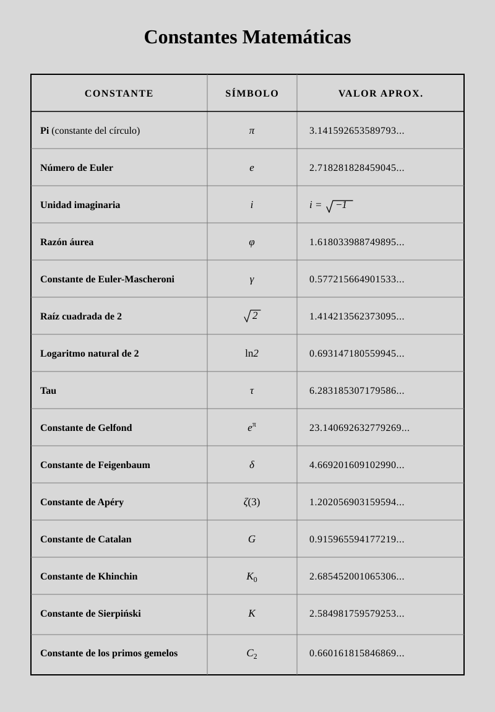

# SA — El fascinante universo de las constantes matemáticas

> Exploración guiada de constantes clásicas (π, *e*, φ, √2, …): significado, historia, representación y aplicación, con producto de exposición tipo «museo».

## 0. Metadatos

| Campo | Contenido |
|-------|-----------|
| **Título de la SA** | El fascinante universo de las constantes matemáticas |
| **Nivel / curso** | 4.º ESO (Matemáticas) · adaptable a 1.º Bachillerato |
| **Duración** | 8–10 sesiones × 50–55 min |
| **Autor/a de la ficha** | Material del repositorio |
| **Fecha / versión** | 2026-10-14 · v1.1 |
| **Contexto de uso** | Diseño curricular / Practicum / TFM / dimensión histórica |

**Palabras clave:** constantes, π, *e*, razón áurea, irracionales, trascendentes, historia de las matemáticas, ABP, socioafectivo

**Anexo de consulta en profundidad:** [Contexto histórico y matemático de las constantes](anexo-contexto-historico-constantes.md)

---

## Tabla de referencia (imagen de partida)

*Fuente visual de la SA: quince constantes con símbolo y valor decimal aproximado. Cada equipo profundiza en un subconjunto (2–3), no en las quince a la vez.*

---

## 1. Pregunta guía / reto

> ¿Qué tienen en común números tan distintos como π, *e* o φ, y cómo podemos explicar a un público escolar *por qué importan*, de dónde salen y cómo se usan?

**Producto final esperado:**  
**«Museo interactivo de los números universales»**: cada equipo elabora un estandarte / infografía (cartel o panel digital) de 2–3 constantes asignadas, con: (1) definición y símbolo, (2) valor y tipo de número (irracional / trascendente / complejo cuando aplique), (3) una idea matemática clave o construcción, (4) contexto histórico breve, (5) una aplicación o curiosidad verificable. Exposición oral breve (3–5 min) + visita del resto del grupo.

---

## 2. Justificación y sentido educativo

Las constantes no son «números raros para memorizar»: condensan relaciones geométricas, límites, series y modelos. Trabajarlas permite:

- Conectar **sentido numérico** (irracionales, trascendentes, complejos) con **geometría** y **álgebra**.
- Introducir la **dimensión histórica y cultural** de las matemáticas (LOMLOE: matemáticas como construcción humana).
- Entrenar la búsqueda de fuentes fiables y la distinción entre anécdota y resultado demostrado.
- Preparar puentes a 1.º Bachillerato (límites, logaritmos, números complejos, series).

No se pretende un curso de teoría de números: se pretende **criterio** al hablar de constantes y **argumentación** clara.

**SA hermanas en el repo:** [Hamlet y los dígitos de π](sa-hamlet-pi-4eso.md) · [Falacia π = 4](sa-falacia-pi-4-4eso.md) · [Eratóstenes](sa-eratostenes-3eso.md).

---

## 3. Objetivos de aprendizaje

1. Identificar y explicar el significado matemático de al menos dos constantes de la tabla (definición operativa, no solo el valor decimal).
2. Clasificar ejemplos como racional / irracional / trascendente / complejo cuando la evidencia lo permita (o señalar qué queda abierto, p. ej. racionalidad de γ).
3. Situar históricamente el origen o popularización de las constantes trabajadas (autor, época, problema que motivó el estudio).
4. Comunicar con rigor y claridad en un panel y una exposición breve, citando fuentes.
5. Cooperar en la construcción del «museo» y revisar el trabajo de otros equipos con criterios visibles.

---

## 4. Competencias específicas y criterios de evaluación

> Ajustar códigos al anexo de Matemáticas del decreto autonómico (en Aragón: Orden ECD/1172/2022 y modificación ECD/867/2024). La numeración siguiente es **sintética** alineada con el RD 217/2022 / práctica del repo.

| CE (síntesis) | Criterios prioritarios | Evidencia en esta SA |
|---------------|------------------------|----------------------|
| **CE3** Razonamiento y argumentación | Justificar definiciones y propiedades; distinguir conjetura y teorema | Texto del panel + respuestas en la exposición |
| **CE6** Conexiones | Relacionar constantes con geometría, análisis o probabilidad | Apartado de aplicaciones / conexiones |
| **CE7** Representación | Símbolos, diagramas, valores, tablas | Infografía / estandarte |
| **CE8** Comunicación | Exposición clara y precisa | Presentación oral del museo |
| **CE9–CE10** Socioafectivas | Perseverancia, cooperación, gestión del error al contrastar fuentes | Observación + auto/coevaluación |

**Competencia protagonista:** CE3 (argumentación) + comunicación del producto.  
**Competencias clave:** STEM, CCL, CD, CPSAA, CCEC.

---

## 5. Saberes básicos y sentidos matemáticos

| Sentido | Saberes / contenidos | Prioridad |
|---------|----------------------|----------|
| Numérico | Números reales; irracionales; idea de trascendente; *i* y complejos (nivel introductorio) | Alta |
| De la medida | Razones (π, τ, φ); longitudes (√2) | Alta |
| Espacial | Circunferencia, diagonal del cuadrado, proporciones | Media–Alta |
| Algebraico | Límites informales (*e*, γ); series sencillas (ln 2, ζ(3), *G*) | Media |
| Estocástico | Densidad de primos gemelos (idea de *C*₂) a nivel divulgativo | Baja–Media |
| Socioafectivo | Valoración de la matemática como cultura; trabajo en equipo | Alta |

**Conexiones interdisciplinares:** Historia; Arte (φ); Física / biología (crecimiento, *e*, semivida y ln 2); Tecnología (cálculo numérico).

**Temarios Aragón:** [temarios Matemáticas LOMLOE](../../01-asignaturas/diseno-curricular-e-instruccional-de-matematicas/materiales/temarios-matematicas-aragon/).

---

## 6. Secuencia de aprendizaje

| Sesión | Fase | Actividad del alumnado | Rol docente | Agrupamiento |
|--------|------|------------------------|-------------|--------------|
| 1 | Activación | Observar la tabla SVG; clasificar constantes conocidas / desconocidas; lluvia de ideas sobre «¿qué es una constante?» | Presentar el reto del museo; no adelantar fichas completas | Individual → clase |
| 2 | Exploración guiada | Mini-taller común: π (razón L/D) y √2 (diagonal); medición o construcción | Andamiaje geométrico; conectar con [falacia π=4](sa-falacia-pi-4-4eso.md) si conviene | Parejas / equipos |
| 3 | Asignación e investigación | Cada equipo recibe 2–3 constantes; consulta el [anexo histórico](anexo-contexto-historico-constantes.md) y otras fuentes; redacta definición, tipo, historia breve, aplicación | Facilitar criterios del panel; evitar copia literal del anexo | Equipos 3–4 |
| 4–5 | Profundización | Construcción GeoGebra o cálculo (p. ej. aproximar *e* o φ); contrastar mitos (p. ej. φ «en todo el arte») | Revisar borradores; señalar afirmaciones sin prueba | Equipos |
| 6–7 | Producto | Diseño del estandarte / infografía; ensayo de exposición | Checklist de calidad del panel | Equipos |
| 8 | Museo | Montaje y visita rotativa; preguntas entre equipos | Moderar; registrar evidencia de CE | Grupo-clase |
| 9 (opc.) | Síntesis | Mapa colectivo de relaciones (π–τ, *e*–ln, φ–Fibonacci…); autoevaluación | Cierre conceptual | Clase |
| 10 (opc. Bach.) | Ampliación | Límite de $(1+1/n)^n$; serie de ln 2; idea de trascendencia | Nivel Bachillerato | Equipos / individual |

**Hito intermedio (sesión 5):** borrador del panel con definición + una fuente citada por constante.

---

## 7. Metodología y organización

- **Enfoque:** ABP / investigación guiada + exposición.
- **Agrupamientos:** equipos heterogéneos de 3–4; roles (documentalista, matemático, diseñador, portavoz).
- **Espacios:** aula; opcional aula de informática (GeoGebra, búsqueda).
- **Materiales:** tabla SVG; [anexo histórico-matemático](anexo-contexto-historico-constantes.md); regla/compás; calculadora; cartulinas o plantilla digital.

---

## 8. Evaluación

> [Instrumentos](../../07-evaluacion/instrumentos/) · [Rúbricas](../../07-evaluacion/rubricas/) · [Alineación criterio–tarea–evidencia](../../07-evaluacion/ejemplos/alineacion-criterio-tarea-evidencia.md).

### 8.1. Evaluación formativa

- [x] Ticket de entrada / salida
- [x] Observación de proceso
- [x] Lista de cotejo del panel (definición, rigor, fuente, aplicación)
- [x] Autoevaluación de cierre
- [x] Coevaluación en la visita al museo

### 8.2. Evaluación sumativa del producto

| Criterio | Indicadores orientativos | Peso |
|----------|--------------------------|------|
| Corrección matemática | Definiciones y valores coherentes; tipo de número bien planteado | 30 % |
| Argumentación e historia | Contexto verosímil; distingue anécdota y resultado | 25 % |
| Comunicación y representación | Panel legible; exposición clara | 25 % |
| Proceso socioafectivo | Cooperación; revisión de fuentes; respeto en el museo | 20 % |

**Alineación:** se valora la **calidad del argumento y de las fuentes**, no la memorización de quince decimales ni la copia del anexo.

### 8.3. Autoevaluación y coevaluación

Ítems visibles: «definí bien la constante / cité una fuente fiable / expliqué sin leer el cartel / mejoré el panel tras la revisión».

---

## 9. Atención a la diversidad y DUA

| Principio DUA | Medida concreta |
|---------------|-----------------|
| **Implicación** | Elección (parcial) de constantes; reto de museo público; roles diversos |
| **Representación** | Tabla SVG, construcciones geométricas, fórmulas, vídeo corto opcional |
| **Acción y expresión** | Panel escrito, oral, digital; plantilla con huecos |

**Refuerzo:** constantes prioritarias π, *e*, φ, √2; ficha modelo rellenada a medias.  
**Ampliación:** γ (problema abierto), ζ(3), *C*₂, Feigenbaum; [anexo](anexo-contexto-historico-constantes.md) completo.

---

## 10. Dimensión socioafectiva

| Elemento | Manifestación observable |
|----------|---------------------------|
| Gestión del error | Corregir un dato histórico o un valor tras contrastar fuentes |
| Perseverancia | Completar el panel pese a definiciones técnicas |
| Cooperación | Reparto equitativo de roles; ayuda entre equipos en el museo |
| Autoconcepto | Explicar una idea difícil con palabras propias |
| Valor cultural | Reconocer la matemática como obra colectiva histórica |

---

## 11. Orientaciones para la implementación

- **Dificultades:** saturación si se exigen las 15 constantes; mitos sobre φ; confusión irracional/trascendente.
- **Anticipación:** repartir **2–3 constantes por equipo**; exigir siempre definición + una fuente; usar el [anexo histórico](anexo-contexto-historico-constantes.md) como **consulta**, no como texto para copiar.
- **Variante corta (5–6 sesiones):** solo π, *e*, φ, √2, *i* + museo reducido.
- **Variante Bachillerato:** añadir límites y series; discusión breve de trascendencia (Gelfond–Schneider a nivel idea).
- **Precisión:** la racionalidad de **γ** y de **$G$** **sigue abierta**; no presentarlas como demostradas.

---

## 12. Referencias

### Normativa
- [RD 217/2022](https://www.boe.es/buscar/act.php?id=BOE-A-2022-4975) (ESO).
- [RD 243/2022](https://www.boe.es/buscar/act.php?id=BOE-A-2022-5521) (Bachillerato).
- Aragón: Orden ECD/1172/2022 y Orden ECD/867/2024 (concreción curricular ESO).

### Didáctica y recursos
1. [**Anexo: contexto histórico y matemático de las constantes**](anexo-contexto-historico-constantes.md) (consulta en profundidad).
2. Manuales de análisis / teoría de números a nivel divulgativo.
3. Hartl, M. — *The Tau Manifesto* (debate π vs τ; lectura crítica, no dogma).

### Materiales del repositorio
- [Plantilla SA](plantilla-situacion-aprendizaje.md)
- [media/constantes-matematicas.svg](media/constantes-matematicas.svg)
- [SA Hamlet–π](sa-hamlet-pi-4eso.md) · [SA falacia π = 4](sa-falacia-pi-4-4eso.md) · [SA Eratóstenes](sa-eratostenes-3eso.md)
- [07-evaluación](../../07-evaluacion/)
- [Temarios Matemáticas Aragón](../../01-asignaturas/diseno-curricular-e-instruccional-de-matematicas/materiales/temarios-matematicas-aragon/)
- [Ejemplos CE Matemáticas](../../01-asignaturas/diseno-curricular-e-instruccional-de-matematicas/materiales/ejemplos-competencias-especificas-matematicas.md)

---

## 13. Resumen rápido de constantes (vista corta)

> Detalle ampliado: **[anexo histórico y matemático](anexo-contexto-historico-constantes.md)**.

1. **π** — Razón longitud/diámetro. Irracional y trascendente. Arquímedes / Euler.  
2. ***e*** — $\lim(1+1/n)^n$; $e^x$ = su derivada. Bernoulli / Euler.  
3. ***i*** — $i^2=-1$. Complejos. Cardano, Bombelli, Euler, Gauss.  
4. **φ** — $(1+\sqrt{5})/2$. Euclides; Pacioli (prudencia con mitos artísticos).  
5. **γ** — $H_n - \ln n$. Racionalidad **abierta**.  
6. **√2** — Diagonal del cuadrado. Crisis pitagórica.  
7. **ln 2** — $\int_1^2 dx/x$; serie de Mercator.  
8. **τ** — $2\pi$. Debate didáctico (Palais, Hartl).  
9. ***e*^(π)** — Trascendente (línea Gelfond–Schneider).  
10. **δ** (Feigenbaum) — Bifurcaciones y caos.  
11. **ζ(3)** (Apéry) — $\sum 1/n^3$; irracional.  
12. ***G*** (Catalan) — Serie alternada de impares al cuadrado; racionalidad abierta.  
13. ***K*₀** (Khinchin) — Media geométrica de coeficientes de fracciones continuas.  
14. ***K*** (Sierpiński) — Problema del círculo / sumas de dos cuadrados.  
15. ***C*₂** — Hardy–Littlewood; densidades de primos gemelos (conjetural).
