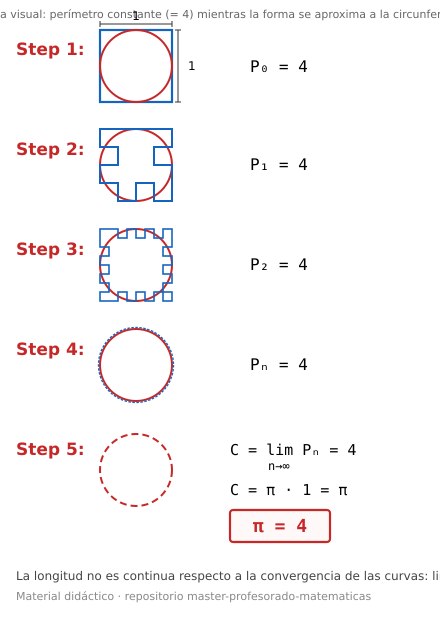

# SA — ¿Es π igual a 4? Desmontando una falacia visual

> Situación de aprendizaje centrada en la distinción entre convergencia de formas y convergencia de longitudes, el sentido de la medida y el razonamiento crítico ante argumentos visuales engañosos.

## 0. Metadatos

| Campo | Contenido |
|-------|-----------|
| **Título de la SA** | ¿Es π igual a 4? Desmontando una falacia visual |
| **Nivel / curso** | 4.º ESO (Matemáticas) · adaptable a 1.º Bachillerato |
| **Duración** | 5 sesiones × 50–55 min |
| **Autor/a de la ficha** | Material del repositorio |
| **Fecha / versión** | 2026-10-14 · v1.0 |
| **Contexto de uso** | Diseño curricular / Practicum / TFM / pensamiento crítico matemático |

**Palabras clave:** π, falacia geométrica, perímetro, límite, convergencia, medida, argumentación, GeoGebra, socioafectivo

---

## Imagen de partida (el «argumento» visual)

*Cuadrado de lado 1 (perímetro 4) que encierra una circunferencia de diámetro 1. En cada paso se recortan esquinas: la forma se acerca a la circunferencia, pero el perímetro permanece igual a 4. El salto final «por tanto π = 4» es la falacia.*

---

## 1. Pregunta guía / reto

> ¿Cómo puede una sucesión de polígonos que «se parece cada vez más» a una circunferencia mantener siempre perímetro 4 y llevarnos a concluir que π = 4? ¿Dónde se rompe el razonamiento?

**Producto final esperado:**  
Informe de equipo (o póster + exposición breve) que contenga: (1) reconstrucción clara de la construcción visual paso a paso, (2) identificación precisa del punto donde falla el argumento, (3) contraste con una aproximación válida (polígonos regulares inscritos/circunscritos), (4) reflexión sobre por qué la longitud de una curva no es una función continua respecto a la convergencia puntual de las curvas, y (5) autoevaluación del proceso de argumentación.

---

## 2. Justificación y sentido educativo

La imagen que «demuestra» que π = 4 es un meme matemático recurrente. Parte de un cuadrado de lado 1 (perímetro 4) que encierra una circunferencia de diámetro 1 y, mediante recortes sucesivos de esquinas, genera una sucesión de curvas poligonales que visualmente se aproximan a la circunferencia sin alterar nunca el perímetro. El salto final —«por tanto la circunferencia mide 4 y π = 4»— es la falacia.

Es relevante porque:

- Enfrenta al alumnado a un argumento visualmente persuasivo pero incorrecto, obligándole a discriminar entre «parecerse» y «tener la misma longitud».
- Trabaja de forma significativa la idea de límite (aunque sea informal) y la continuidad de la función longitud de arco.
- Desarrolla el sentido crítico ante demostraciones «obvias» y refuerza la necesidad de justificar por qué una aproximación es válida.
- Conecta con el sentido de la medida y el espacial de forma no rutinaria.

**Historia matemática hermana (opcional):** el método de Arquímedes con polígonos regulares inscritos y circunscritos, que *sí* produce una aproximación legítima de π. En el repo: [Hamlet y los dígitos de π](sa-hamlet-pi-4eso.md) (otro enfoque sobre π).

---

## 3. Objetivos de aprendizaje

1. Reconstruir con precisión la sucesión de polígonos de la falacia y verificar que el perímetro se conserva en cada paso.
2. Identificar y explicar el error lógico-matemático: la convergencia de las curvas (en distancia) no implica la convergencia de las longitudes.
3. Contrastar la construcción falaz con una aproximación legítima mediante polígonos regulares (perímetro que sí tiende a \(2\pi r\)).
4. Formular un argumento claro, oral o escrito, que desmonte la falacia sin limitarse a «π no es 4».
5. Reflexionar sobre la importancia de la continuidad de la función longitud y sobre la gestión del error cuando un razonamiento «parece» correcto.

---

## 4. Competencias específicas y criterios de evaluación

| CE (síntesis) | Criterios prioritarios | Evidencia principal en esta SA |
|---------------|------------------------|--------------------------------|
| **CE3** Razonamiento y argumentación | Detectar falacias; justificar por qué un límite no se puede intercambiar | Explicación escrita/oral del punto de ruptura del argumento |
| **CE1–CE2** Resolución de problemas | Analizar una construcción geométrica; proponer contraste válido | Reconstrucción paso a paso + comparación con polígonos regulares |
| **CE6** Modelización | Distinguir modelo visual engañoso de modelo matemáticamente coherente | Apartado del informe que formaliza la idea de límite de longitudes |
| **CE7** Representación | Diagramas, sucesiones de figuras, GeoGebra | Figuras numeradas y (opcional) applet dinámico |
| **CE9–CE10** Socioafectivas | Gestión del error; perseverancia en la argumentación; debate respetuoso | Observación de proceso + auto/coevaluación |

**Competencia protagonista:** CE3 (razonamiento y argumentación).  
**Competencias clave:** STEM, CCL, CPSAA, CD (si se usa GeoGebra).

> Ajustar la numeración de CE al anexo de Matemáticas del decreto autonómico del centro (p. ej. Orden ECD/1172/2022 en Aragón).

---

## 5. Saberes básicos y sentidos matemáticos

| Sentido | Saberes / contenidos | Prioridad |
|---------|----------------------|----------|
| Espacial | Circunferencia, polígonos, aproximación de curvas, distancia entre curvas | Alta |
| De la medida | Longitud de arco / perímetro; conservación de longitud bajo recortes; no continuidad de la longitud | Alta |
| Algebraico | Sucesiones; idea informal de límite; contraste \(\lim\) longitud ≠ longitud del límite | Media–Alta |
| Numérico | Valor de π; comparación numérica de perímetros de polígonos regulares | Media |
| Socioafectivo | Gestión del error; tolerancia a la frustración ante argumentos persuasivos; argumentación respetuosa | Alta |
| Estocástico | N/A | Baja |

**Conexiones interdisciplinares:** Filosofía / pensamiento crítico (falacias); Tecnología (GeoGebra); Historia de las matemáticas (método de Arquímedes).

---

## 6. Secuencia de aprendizaje

| Sesión | Fase | Actividad del alumnado | Rol docente | Agrupamiento |
|--------|------|------------------------|-------------|--------------|
| 1 | Activación / reto | Observación de la imagen; lluvia de ideas: «¿dónde está el truco?»; reconstrucción colectiva de los primeros pasos; hipótesis iniciales por escrito | Presentar la imagen **sin** dar la solución; recoger hipótesis en pizarra | Individual → clase |
| 2 | Exploración | Verificar experimentalmente (papel, regla o GeoGebra) que el perímetro se mantiene constante; dibujar 3–4 iteraciones; medir o calcular longitudes | Andamiaje con preguntas («¿qué se conserva? ¿qué cambia?»); evitar adelantar el diagnóstico | Equipos de 3–4 |
| 3 | Contraste | Construir o calcular perímetros de polígonos regulares de 4, 8, 16… lados inscritos/circunscritos; observar que el perímetro sí se aproxima a \(2\pi r\); comparar ambas sucesiones | Introducir la distinción convergencia de formas vs. convergencia de longitudes | Equipos |
| 4 | Formalización y producto | Redactar el informe: localizar el fallo, explicar por qué la longitud no es continua, contrastar con Arquímedes/polígonos regulares; preparar exposición breve | Revisar borradores; ofrecer plantilla de estructura del informe | Equipos |
| 5 | Comunicación y cierre | Presentaciones o puesta en común; debate sobre otras falacias visuales; autoevaluación socioafectiva; síntesis docente | Moderar; celebrar la diversidad de formulaciones correctas del error | Grupo-clase |

**Hito intermedio (sesión 3):** tabla o figura que contraste los perímetros de la sucesión falaz (constantes = 4) con los de los polígonos regulares (que se acercan a π·diámetro).

---

## 7. Metodología y organización

- **Enfoque:** indagación + razonamiento crítico + modelización geométrica.
- **Agrupamientos:** equipos heterogéneos de 3–4 (roles posibles: dibujante/constructor, calculista, argumentador, portavoz).
- **Espacios:** aula ordinaria; opcional aula de informática para GeoGebra (sesiones 2–3).
- **Materiales y recursos:** imagen de la falacia (arriba / impresa); papel milimetrado, regla; GeoGebra (construcción propia o applet); calculadora; plantilla de informe.

---

## 8. Evaluación

> Reutilizar plantillas del repo: [instrumentos](../../07-evaluacion/instrumentos/) · [rúbricas CE](../../07-evaluacion/rubricas/) · [ejemplo de alineación](../../07-evaluacion/ejemplos/alineacion-criterio-tarea-evidencia.md).

### 8.1. Evaluación formativa

- Instrumentos:
  - [x] Ticket de entrada / salida (sesión 1 y 5)
  - [x] Observación de proceso (Pólya: comprensión, plan, ejecución, revisión)
  - [x] Lista de cotejo de argumentación
  - [x] Portfolio de errores / borradores de explicación
  - [ ] Audio 60–90 s (opcional)
  - [x] Autoevaluación de cierre
- Momentos de feedback: *feed-up* en sesión 1 (reto claro); *feed-back* en sesiones 2–3; *feed-forward* en sesión 4 (mejora del informe antes de la presentación).

### 8.2. Evaluación sumativa del producto

| Criterio | Indicadores orientativos | Peso |
|----------|--------------------------|------|
| Reconstrucción de la falacia | Figuras claras y verificación de perímetro constante | 20 % |
| Identificación del error | Localización precisa del salto lógico + explicación de la no continuidad de la longitud | 30 % |
| Contraste con aproximación válida | Polígonos regulares o Arquímedes; datos numéricos o gráficos | 20 % |
| Comunicación | Claridad, rigor, uso de representaciones | 15 % |
| Proceso socioafectivo | Cooperación, revisión entre iguales, gestión del error | 15 % |

**Alineación:** la nota refleja la calidad de la argumentación (CE3) y no solo el «resultado correcto» (π ≠ 4).

### 8.3. Autoevaluación y coevaluación

Escala breve visible: «identifiqué el punto débil del argumento / contrasté con un método válido / escuché y mejoré la explicación de un compañero / persistí cuando el razonamiento se complicó».  
Coevaluación del informe de otro equipo: una fortaleza + una sugerencia de mejora (criterios visibles).

---

## 9. Atención a la diversidad y DUA

| Principio DUA | Medida concreta en esta SA |
|---------------|----------------------------|
| Múltiples formas de **implicación** | Imagen impactante como gancho; roles opcionales; meta realista («explicar por qué falla, no solo decir que π no es 4») |
| Múltiples formas de **representación** | Imagen estática, construcción manual, GeoGebra dinámico, tabla numérica de perímetros, esquema escrito del argumento |
| Múltiples formas de **acción y expresión** | Informe escrito, póster, exposición oral, vídeo corto; plantillas con huecos para quien lo necesite |

**Refuerzo:** plantilla de informe guiada; calculadora y figuras pre-dibujadas; foco en la idea cualitativa («la longitud no se hereda automáticamente»).  
**Ampliación:** formalización con distancia de Hausdorff o norma del supremo; analogía con la longitud de la costa (Richardson) / fractal; comparación con el perímetro infinito de la curva de Koch.

---

## 10. Dimensión socioafectiva

Relacionada con CE9–CE10 / sentido socioafectivo:

| Elemento | Manifestación observable en la SA |
|----------|-----------------------------------|
| Gestión del error | Aceptar que un razonamiento visualmente atractivo puede ser falso y buscar dónde se rompe |
| Perseverancia | Rehacer la construcción o el contraste cuando la primera explicación resulta insuficiente |
| Flexibilidad cognitiva | Pasar de «π no puede ser 4» a «el límite de las longitudes no coincide con la longitud del límite» |
| Cooperación y empatía | Explicar el fallo a un compañero sin ridiculizar la intuición inicial |
| Autoconcepto matemático | Valorar la calidad del argumento aunque el punto de partida fuera confuso |

Registro: observación de proceso + ítems de la autoevaluación de cierre.

---

## 11. Orientaciones para la implementación

- **Dificultades previsibles:** quedarse en «es obvio que π ≠ 4»; confundir convergencia de áreas (que sí ocurre) con convergencia de perímetros; pensar que «cualquier aproximación por polígonos es válida».
- **Anticipación:** insistir desde la sesión 1 en que el reto no es saber el valor de π, sino **localizar el error del argumento**.
- **Variante corta (3 sesiones):** imagen + reconstrucción + contraste con un solo polígono regular + debate final.
- **Variante con tecnología:** GeoGebra dinámico de la sucesión falaz + cálculo de perímetros de polígonos regulares.
- **Variante Bachillerato:** introducir la noción de continuidad de la función longitud de arco y la necesidad de convergencia en normas más fuertes (p. ej. variación acotada).
- **Extensión:** otras falacias geométricas clásicas a nivel divulgativo.

---

## 12. Referencias

### Normativa
- [RD 217/2022](https://www.boe.es/buscar/act.php?id=BOE-A-2022-4975) (ESO).
- Decreto autonómico del centro (p. ej. Orden ECD/1172/2022 y ECD/867/2024 en Aragón).

### Didáctica y recursos
1. Discusiones clásicas de la falacia «π = 4» (construcciones tipo *staircase* / *pi = 4 fallacy* en foros de matemáticas y GeoGebra).
2. Método de Arquímedes de aproximación de π mediante polígonos regulares (contexto histórico de aproximación legítima).
3. Idea de no continuidad de la longitud de arco respecto a la convergencia uniforme de curvas (nivel divulgativo o Bachillerato).

### Materiales del repositorio
- [Plantilla SA](plantilla-situacion-aprendizaje.md)
- [07-evaluacion](../../07-evaluacion/) (instrumentos y rúbricas)
- SA relacionadas: [Eratóstenes](sa-eratostenes-3eso.md) · [Hamlet y los dígitos de π](sa-hamlet-pi-4eso.md)
- Diagrama: [media/falacia-pi-4.svg](media/falacia-pi-4.svg)

---

## 13. Anexo — Guía rápida para el docente

**Idea clave del error:**  
Las curvas \(C_n\) convergen a la circunferencia \(C\) en el sentido de que la distancia máxima entre puntos de \(C_n\) y \(C\) tiende a 0. Sin embargo, la función  

\[
\text{longitud}: \{\text{curvas}\} \to \mathbb{R}
\]

no es continua respecto a esa topología. Por tanto

\[
\lim_{n\to\infty} \text{longitud}(C_n) = 4 \neq \pi = \text{longitud}(C).
\]

**Contraste útil (polígonos regulares de \(2^k\) lados):**  
El perímetro sí tiende a \(2\pi r\). La diferencia esencial es que los lados son cuerdas (o tangentes) cuyos extremos están sobre la circunferencia y la dirección de los lados se alinea progresivamente con la tangente.

**Área vs. perímetro:**  
Las áreas de las regiones limitadas por \(C_n\) **sí** convergen al área del círculo; solo el perímetro falla. Esto ayuda a separar las dos magnitudes.

**Imagen de partida:** [media/falacia-pi-4.svg](media/falacia-pi-4.svg) (también reproducible a mano en la pizarra o con GeoGebra).
