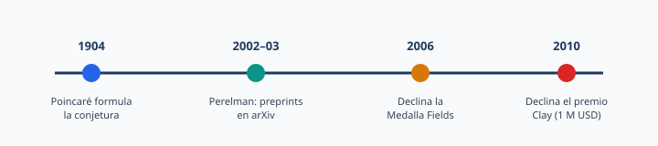
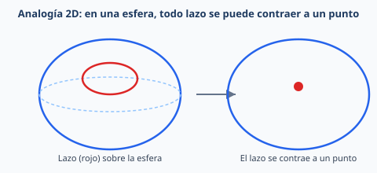

# SA — Perelman, la conjetura de Poincaré y el valor social del conocimiento

> Propuesta **sociocrítica** para Matemáticas en 4.º ESO o 1.º de Bachillerato: validación científica, preprints, premios y acceso abierto a partir de un caso real.

## 0. Metadatos

| Campo | Contenido |
|-------|-----------|
| **Título de la SA** | Perelman, la conjetura de Poincaré y el valor social del conocimiento |
| **Nivel / curso** | 4.º ESO (Matemáticas) · adaptable a 1.º Bachillerato |
| **Duración** | 4 sesiones × 55 min |
| **Autor/a de la ficha** | Material del repositorio (a partir de propuesta sociocrítica validada) |
| **Fecha / versión** | 2026-10-15 · v1.0 |
| **Contexto de uso** | Diseño curricular / Practicum / dimensión ética y mediática de las matemáticas |
| **Áreas** | Matemáticas · Lengua · Tecnología · Valores cívicos y éticos |

**Palabras clave:** conjetura, demostración, topología, preprint, arXiv, Medalla Fields, premio Clay, acceso abierto, pensamiento crítico mediático, sociocrítico

---

## 1. Pregunta guía / reto

> ¿Quién decide qué conocimiento tiene valor y qué significa tener éxito: resolver un problema, demostrarlo ante una comunidad, publicarlo, recibir premios o contribuir al conocimiento común?

**Producto final esperado:**  
Equipos elaboran una **exposición pública breve** (póster, infografía o presentación oral de 3–5 min) que:

1. Explique la conjetura con una **analogía accesible** (y sus límites).  
2. **Verifique** las afirmaciones de una publicación viral / imagen mediática.  
3. Argumente una **posición razonada** sobre validación científica, reconocimiento y acceso abierto.

---

## 2. Recursos visuales de la ficha

### Línea temporal (hechos documentados)

### Analogía geométrica (intuición, no demostración)

*La analogía de la esfera 2D ayuda a intuir «simplemente conexa»; **no** es la demostración de Perelman ni el enunciado completo en dimensión 3.*

---

## 3. Validación de la narrativa mediática

Principio de trabajo: una afirmación viral **no** es automáticamente falsa por ser viral, ni verdadera por resultar inspiradora. Se contrasta con fuentes, fechas y límites de lo que sabemos.

| Afirmación habitual | Evaluación rigurosa |
|---------------------|---------------------|
| «En 2002 publicó una demostración en internet» | **Correcto en esencia:** Perelman subió **tres preprints** a arXiv (2002 y 2003), textos técnicos, no un único artículo de revista tradicional. La comunidad examinó y desarrolló exposiciones detalladas de la prueba en los años siguientes. |
| «Resolvió un problema de casi 100 años» | **Resumen válido:** la conjetura se formuló en **1904**; la solución se hizo pública en **2002–2003**. Preferible: «problema abierto durante aproximadamente un siglo». |
| «Nunca publicó en una revista tradicional» | **Matiz:** los originales fueron **preprints**, no artículos convencionales con revisión por pares editorial. Eso **no** implica ausencia de revisión experta: hubo análisis por especialistas y exposiciones posteriores (p. ej. Morgan y Tian). |
| «Rechazó la Medalla Fields en 2006» | **Documentado** por la Unión Matemática Internacional (IMU). |
| «Rechazó un millón de dólares en 2010» | **Documentado** por el Clay Mathematics Institute y la prensa contemporánea. Evitar atribuir motivos psicológicos o políticos **sin fuente directa fiable**. |

---

## 4. ¿Qué dice la conjetura de Poincaré? (nivel ESO / 1.º Bach.)

**Formulación formal (referencia):** toda variedad tridimensional compacta, sin borde y simplemente conexa es homeomorfa a la 3-esfera \(S^3\).

**Lectura escolar (intuitiva):**

- En topología se estudian propiedades que se conservan al deformar de forma continua (sin «romper» ni «pegar» de manera que cambie la estructura esencial).
- **Simplemente conexa** (intuición): cualquier lazo cerrado se puede contraer de forma continua hasta un punto (como en la analogía de la esfera de la figura).
- La conjetura pregunta, en dimensión 3, si esa propiedad (junto con otras hipótesis técnicas: compacta, sin borde) basta para identificar el espacio con la 3-esfera.

**Lo que no se pide en ESO:** demostrar el resultado ni estudiar el flujo de Ricci. Se pide **comprender la diferencia entre conjetura y teorema**, usar una analogía con límites claros y contrastar fuentes.

**Glosario mínimo**

| Término | Significado operativo |
|---------|----------------------|
| **Conjetura** | Afirmación propuesta como verdadera, aún no demostrada en el momento de formularse |
| **Demostración** | Cadena de argumentos lógicos aceptados por la comunidad matemática |
| **Topología** | Estudio de propiedades invariantes bajo deformaciones continuas adecuadas |
| **Homeomorfismo** | Equivalencia topológica (correspondencia continua invertible con inversa continua) |
| **Preprint** | Versión compartida antes o al margen de la publicación formal en revista |
| **Revisión por pares** | Evaluación por especialistas; control de calidad, no garantía infalible de verdad |

---

## 5. Justificación y sentido educativo

- Conectar **matemáticas como actividad humana** (LOMLOE: cultura, historia, valor social) con un caso contemporáneo.
- Entrenar **alfabetización mediática**: contrastar viral vs. fuente primaria / institucional.
- Distinguir **conjetura / demostración / publicación / premio**.
- Abrir el debate sociocrítico: ¿quién valida el conocimiento? ¿Qué papel tienen arXiv, revistas, medallas y dinero?

**SA hermanas:** [Falacia \(\pi = 4\)](sa-falacia-pi-4-4eso.md) (límites de la intuición visual) · [Constantes matemáticas](sa-constantes-matematicas-4eso.md) (historia y rigor) · [Hamlet–\(\pi\)](sa-hamlet-pi-4eso.md).

---

## 6. Objetivos de aprendizaje

1. Explicar, con analogía y límites, la idea central de la conjetura de Poincaré a nivel divulgativo.  
2. Contrastar afirmaciones mediáticas con fuentes fechadas (arXiv, IMU, Clay, prensa).  
3. Distinguir conjetura, demostración, preprint y publicación en revista.  
4. Argumentar una posición sobre reconocimiento, premios y acceso abierto **sin** atribuir motivos no documentados a Perelman.  
5. Cooperar en un producto público claro y citado.

---

## 7. Competencias específicas y criterios (síntesis)

> Ajustar códigos al decreto autonómico (Aragón: ECD/1172/2022 y ECD/867/2024).

| CE (síntesis) | Criterios prioritarios | Evidencia |
|---------------|------------------------|----------|
| **CE3** Razonamiento | Distinguir conjetura / teorema; límites de la analogía | Texto del producto + oral |
| **CE6** Conexiones | Matemáticas, historia, medios, ética del conocimiento | Argumentación final |
| **CE7** Representación | Esquema temporal, analogía visual | Póster / infografía |
| **CE8** Comunicación | Exposición clara y precisa | Defensa oral |
| **CE9–CE10** Socioafectivas | Respeto en el debate; evitar mitificación o desprecio | Observación + coevaluación |

**Competencias clave:** STEM, CCL, CD, CPSAA, CCEC, CC.

---

## 8. Saberes básicos / sentidos

| Sentido | Contenidos prioritarios |
|---------|-------------------------|
| Espacial / geométrico | Intuición topológica elemental; deformación; analogía de la esfera |
| Algebraico / formal | Lenguaje de conjetura y demostración (nivel metalingüístico) |
| Socioafectivo | Valor del conocimiento; reconocimiento; trabajo en equipo |
| Digital / mediático | Fuentes, fechas, preprints, contraste de noticias |

No se pretende introducir el flujo de Ricci ni la técnica de cirugía de variedades.

---

## 9. Secuencia de aprendizaje (4 sesiones)

| Sesión | Fase | Actividad | Rol docente |
|--------|------|-----------|-------------|
| **1** | Activación + validación | Observar imagen / texto viral; clasificar afirmaciones (hecho / simplificación / interpretación) con la tabla §3; línea temporal SVG | Modelar contraste de fuentes; no mitificar |
| **2** | Idea matemática | Analogía de la esfera (§2); glosario; qué es y qué no es la conjetura | Corregir confusión analogía = prueba |
| **3** | Investigación y producto | Equipos: fuentes (arXiv, IMU, Clay, prensa); borrador de póster/infografía con cita y posición argumentada | Checklist de rigor y citas |
| **4** | Exposición y diálogo | Presentaciones; preguntas socráticas; coevaluación; reflexión individual breve | Moderar; registrar evidencia CE |

**Preguntas para el diálogo socrático / sociocrítico**

- ¿Una prueba es verdadera porque la publica una institución prestigiosa, o la institución debe evaluar razones examinables?  
- ¿Compartir un preprint completa todos los procesos de validación? ¿Ventajas y riesgos?  
- ¿Los premios reconocen el conocimiento, la trayectoria, la influencia o las normas de una comunidad?  
- ¿Podemos respetar la decisión de Perelman sin convertirlo en héroe ni atribuirle motivos que no conocemos?  
- ¿Qué condiciones materiales (tiempo, financiación, acceso a bibliografía, estabilidad laboral) hacen posible investigar?

---

## 10. Evaluación

> [Instrumentos](../../07-evaluacion/instrumentos/) · [Rúbricas](../../07-evaluacion/rubricas/)

### Rúbrica analítica (0–3 por criterio)

| Criterio | 1 · Inicial | 2 · En desarrollo | 3 · Logrado |
|----------|-------------|-------------------|-------------|
| **Comprensión matemática** | Confunde analogía con prueba | Explica la intuición con alguna imprecisión | Explica conceptos y **límites** de la analogía |
| **Calidad de las fuentes** | Repite lo viral sin contrastar | Usa fuentes fiables sin distinguir funciones | Contrasta primarias e institucionales; **fecha** los datos |
| **Argumentación crítica** | Opinión sin razones | Razones débiles o sin alternativas | Argumenta, considera contraargumentos, evita atribuciones infundadas |
| **Comunicación y cooperación** | Producto confuso o reparto desigual | Comprensible; colaboración parcial | Claro, accesible, bien citado; trabajo cooperativo |

**Formativa:** ticket de entrada (conjetura vs teorema); observación de proceso; coevaluación en la sesión 4.

---

## 11. DUA y socioafectivo

| Principio DUA | Medida |
|---------------|--------|
| **Implicación** | Reto mediático real; roles (documentalista, matemático, comunicador) |
| **Representación** | SVG temporal + analogía visual + texto + oral |
| **Acción y expresión** | Póster, infografía digital o presentación oral |

| Elemento socioafectivo | Observable |
|------------------------|------------|
| Respeto | No ridiculizar decisiones ajenas documentadas |
| Perseverancia | Completar el contraste de fuentes |
| Autoconcepto | Explicar una idea difícil con palabras propias |
| Pensamiento crítico | Separar hecho, simplificación e interpretación |

---

## 12. Orientaciones

- **No** pedir la demostración ni el flujo de Ricci.  
- **Sí** exigir analogía + límites + fuentes fechadas.  
- Evitar el relato del «genio solitario incomprendido» o el del «loco que rechaza el dinero»: trabajar con **hechos documentados**.  
- Variante Bachillerato: ampliar el glosario (variedad, homeomorfismo) y el debate sobre acceso abierto / ciencia abierta.  
- Variante corta (2–3 sesiones): solo validación mediática + analogía + posición oral.

---

## 13. Referencias

### Fuentes primarias e institucionales

- Perelman, G. (2002). *The entropy formula for the Ricci flow and its geometric applications*. [arXiv:math/0211159](https://arxiv.org/abs/math/0211159)  
- Perelman, G. (2003). *Ricci flow with surgery on three-manifolds*. [arXiv:math/0303109](https://arxiv.org/abs/math/0303109)  
- Perelman, G. (2003). *Finite extinction time for the solutions to the Ricci flow on certain three-manifolds*. [arXiv:math/0307245](https://arxiv.org/abs/math/0307245)  
- International Mathematical Union. *Fields Medals 2006*. [mathunion.org](https://www.mathunion.org/imu-awards/fields-medal/fields-medals-2006)  
- Clay Mathematics Institute — Premio del Milenio / conjetura de Poincaré (consulta institucional del premio y su resolución).

### Exposiciones y consulta

- Morgan, J., & Tian, G. (2006). *Ricci Flow and the Poincaré Conjecture*. [arXiv:math/0607607](https://arxiv.org/abs/math/0607607)  
- Wolfram MathWorld — *Poincaré Conjecture*: [mathworld.wolfram.com/PoincareConjecture.html](https://mathworld.wolfram.com/PoincareConjecture.html)

### Prensa (contrastar, no como única fuente)

- *El País* (2 de julio de 2010). «Perelman rechaza el millón de dólares». [elpais.com](https://elpais.com/diario/2010/07/02/sociedad/1278021608_850215.html)

### Normativa y repo

- [RD 217/2022](https://www.boe.es/buscar/act.php?id=BOE-A-2022-4975) · [RD 243/2022](https://www.boe.es/buscar/act.php?id=BOE-A-2022-5521)  
- [Plantilla SA](plantilla-situacion-aprendizaje.md) · [07-evaluación](../../07-evaluacion/)  
- [SA falacia \(\pi=4\)](sa-falacia-pi-4-4eso.md) · [SA constantes](sa-constantes-matematicas-4eso.md)  
- Temarios Aragón: [temarios-matematicas-aragon](../../01-asignaturas/diseno-curricular-e-instruccional-de-matematicas/materiales/temarios-matematicas-aragon/)

---

*Ficha orientativa. La imagen mediática de partida es objeto de análisis; no sustituye las fuentes primarias enlazadas.*
