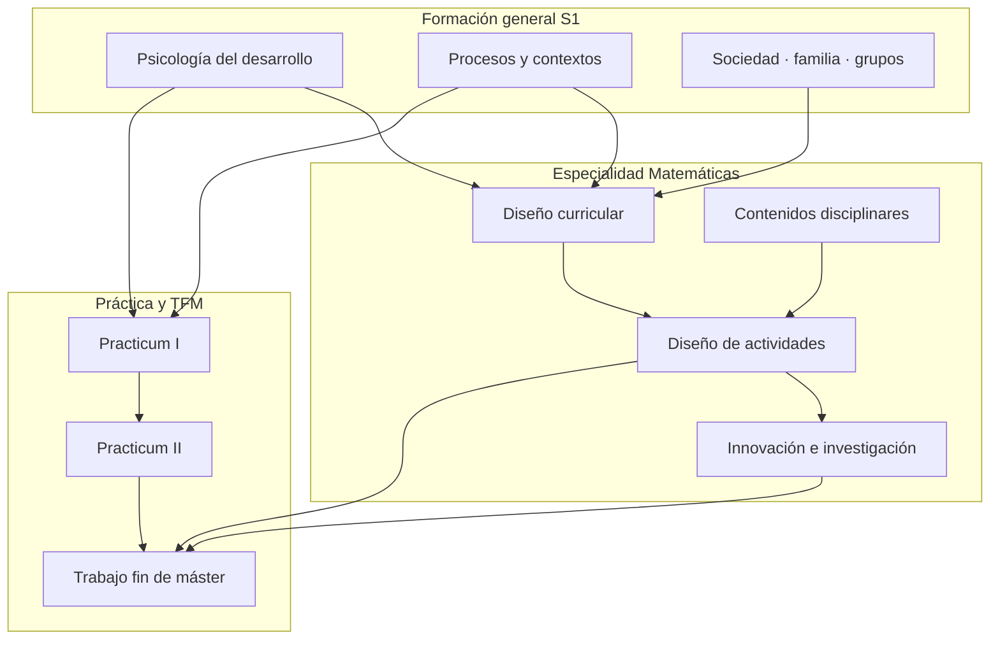

# Máster Universitario en Profesorado — Matemáticas

Repositorio de trabajo del **Máster Universitario en Profesorado de Educación Secundaria**, especialidad **Matemáticas** (marco **LOMLOE** / currículo de Aragón).

Cuaderno digital de estudio y base reutilizable (REA) para la enseñanza de Matemáticas en ESO y Bachillerato.

> **Lectura orientadora del conjunto:** [Los conocimientos fundamentales del Máster: una síntesis para el ejercicio docente](sintesis-conocimientos-fundamentales.md)

---

## Qué puedes encontrar aquí

Este repositorio reúne, en un solo sitio, el material de trabajo de un Máster de Profesorado de Matemáticas (marco LOMLOE, currículo de Aragón). No es un temario oficial ni un manual cerrado: es un **cuaderno digital de estudio** y, al mismo tiempo, una **base de recursos reutilizables** (REA) pensada tanto para quien está formándose como para quien ya está en el aula.

### Si eres estudiante del Máster

Aquí encontrarás los apuntes de las asignaturas obligatorias y optativas, organizados por bloques y con un nivel de desarrollo que va de la semilla a la ficha operativa. Psicología del desarrollo, Procesos y contextos educativos, Sociedad-familia-grupos, Diseño curricular, Contenidos disciplinares, Diseño de actividades e Innovación e investigación tienen materiales propios: temas ampliados, glosarios, bancos de preguntas a tres niveles (fácil / intermedio / difícil) y, en varios casos, fichas de apoyo (ansiedad matemática, neurodivergencia en el aula, protocolos de derivación, etc.).

También hay herramientas concretas para el Prácticum (guías de observación, checklists de sesión, plantillas de diario y de memoria) y un espacio de Trabajo Fin de Máster con ideas elaboradas, un atlas de nichos y ejemplos de TFM reales. Si estás decidiendo tema, las fichas de `ideas-interesantes/` incluyen pregunta central, hipótesis, diseño orientativo y una estimación de solidez científica.

### Si eres profesor en ejercicio

El repositorio funciona como un banco de recursos listos para adaptar. Hay situaciones de aprendizaje (SA) y proyectos ABP, temarios de Matemáticas ESO/Bachillerato alineados con la normativa de Aragón, protocolos de aula (por ejemplo, uso responsable de IA y verificación matemática), rúbricas, fichas de autores y pensadores, y materiales sobre evaluación formativa, DUA y atención a la diversidad. La mayoría de los documentos están escritos para poder copiar, modificar y llevar al aula sin partir de cero.

Además, la carpeta de inteligencia artificial recoge actividades completas (cazador de alucinaciones, diálogo socrático), un catálogo de prompts y una norma de aula modelo. No se trata de «usar IA por usarla», sino de incorporar criterios didácticos, éticos y matemáticamente sólidos.

### Cómo está organizado

La estructura sigue el plan de estudios del Máster, pero con una lógica de uso transversal: los apuntes de asignatura viven en `01-asignaturas/`, los materiales reutilizables en `03-materiales/`, las SA y proyectos en `04-pbl-abp/`, y los recursos de IA, evaluación y podcasts en sus propias carpetas. Un diagrama al inicio de este README muestra cómo se relacionan los bloques de formación general, especialidad, práctica y TFM.

Si acabas de llegar, la lectura más útil para situarte es la [síntesis de conocimientos fundamentales](sintesis-conocimientos-fundamentales.md). A partir de ahí, los `README.md` e `INDICE.md` de cada carpeta sirven de mapa local.


**Mapa de estructura:** [MANIFEST.md](MANIFEST.md) · **Madurez por carpetas:** [ESTADO.md](ESTADO.md)



## Estructura

| Carpeta | Contenido |
|---------|-----------|
| `00-administracion/` | Matrícula, calendario, trámites |
| `01-asignaturas/` | Asignaturas + **`practicum/`** (trabajo anonimizado I/II) |
| `02-apuntes/` | Índice general y **transversales con contenido** (DUA, evaluación, IA…) — [índice](02-apuntes/INDICE.md) |
| `03-materiales/` | Materiales reutilizables |
| `04-pbl-abp/` | SA / ABP |
| `05-python-jupyter/` | Python didáctico + notebooks |
| `06-inteligencia-artificial/` | IA en educación |
| `07-evaluacion/` | Instrumentos y rúbricas |
| `08-podcasts/` | Guiones e índices |
| `09-bibliografia/` | Autores-pensadores |
| `99-archivo/` | Histórico / scripts one-shot |

**Criterio:** apuntes de asignatura → `01-asignaturas/…/apuntes/`. No hay carpetas vacías de “psicología/matemáticas/sociología” bajo `02-apuntes/`.

## Asignaturas obligatorias

| Periodo | Asignatura |
|---|---|
| S1 | Psicología · Procesos · Sociedad-familia-grupos · Practicum I · Diseño curricular |
| S2 | Contenidos disciplinares · Diseño de actividades · Innovación e investigación |
| Anual | Practicum II · TFM |

## Cómo usar este repositorio

1. **Visión de conjunto:** [síntesis de conocimientos fundamentales](sintesis-conocimientos-fundamentales.md).
2. **Estudiar / navegar:** abre los `README.md` e `INDICE.md` de cada carpeta; los apuntes viven en Markdown.
3. **Programación didáctica y currículo:** empieza por [Diseño curricular](01-asignaturas/diseno-curricular-e-instruccional-de-matematicas/).
4. **Situaciones de aprendizaje:** [04-pbl-abp/](04-pbl-abp/).
5. **Notebooks de aula:** [05-python-jupyter/](05-python-jupyter/) (local con Jupyter/VS Code, o **Google Colab** desde los enlaces de esa carpeta).
6. **Clonar:**
   ```bash
   git clone https://github.com/computerphysicslab/master-profesorado-matematicas.git
   ```
7. **Dependencias Python** (solo si ejecutas notebooks en local): `numpy`, `matplotlib` suelen bastar; el resto se indica en cada notebook.

**Stack del proyecto:** Markdown + (sitio) Just the Docs/Jekyll · Mermaid · notebooks Jupyter · recursos abiertos. No hay pipeline LaTeX obligatorio en este repo.

## Licencia

**[CC BY-SA 4.0](LICENSE)** para materiales pedagógicos y, por defecto, scripts/notebooks del propio repo.  
Recursos de terceros: su propia licencia. Textos oficiales (BOE, órdenes): se citan, no se redistribuyen como obra original.

## Contribuir (notas breves)

- Respeta la ubicación de archivos del [MANIFEST](MANIFEST.md).
- No subas trabajos personales, credenciales ni artefactos de compilación (véase `.gitignore`).
- Prefiere Markdown enlazado a PDFs binarios pesados cuando sea posible.
